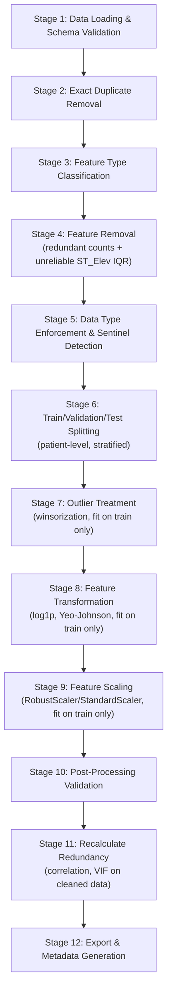

# MIMIC-IV ECGDeLI Feature Preprocessing & Cleaning Pipeline — Implementation Plan

## Problem Statement

The MIMIC-IV-ECG dataset contains **407,446 ECG records** with **160 ECGDeLI-extracted features** that require preprocessing and cleaning before downstream modeling. A comprehensive quality assessment pipeline has already been completed, producing detailed reports comparing MIMIC-IV features against PTB-XL Original (trusted reference) and validating the extraction pipeline itself (PTB-XL Original vs PTB-XL Re-extracted). This plan translates those findings into an actionable preprocessing pipeline.

---

## 1. Understanding the Existing Analysis

### 1.1 Analysis A: PTB-XL Original vs PTB-XL Re-extracted (Extraction Validation)

**Purpose:** Determine whether our ECGDeLI extraction pipeline faithfully reproduces the original PTB-XL features. This tells us *which features from our extraction code can be trusted* when applied to MIMIC-IV.

**Key Findings:**

| Finding | Evidence | Preprocessing Impact |
|---|---|---|
| **42 features have Excellent agreement** (ICC ≥ 0.95, MAPE < 5%) | [paired_validation_report.csv](file:///C:/Users/Acer/Desktop/Capstone/SCM/data/raw/new_analysis_pipeline/outputs/tables/validation/paired_validation_report.csv) | These features are reliably extracted; no extraction-related concerns |
| **45 features have Poor agreement** (ICC < 0.50) | Same report, lines 116–161 | These features are *unreliable outputs of the extraction pipeline itself*, particularly ST_Elev IQR features (ICC 0.02–0.06) and several amplitude IQR features |
| **ST_Elev_*_iqr features are the worst** | ICC range 0.02–0.06 for ST_Elev_aVL_iqr, ST_Elev_III_iqr, ST_Elev_I_iqr, etc. | These features are essentially noise from the extraction process — candidates for removal |
| **Batch effect accuracy 0.9957** | [batch_effect_report.txt (validation)](file:///C:/Users/Acer/Desktop/Capstone/SCM/data/raw/new_analysis_pipeline/outputs/tables/validation/batch_effect_report.txt) | Systematic differences exist in extraction; ST_Elev_aVL_iqr alone accounts for 60.6% of the discriminating power |
| **ST_Elev features have 15.5% missing in PTB-XL Original but 0% in re-extracted** | [missingness_report.csv (validation)](file:///C:/Users/Acer/Desktop/Capstone/SCM/data/raw/new_analysis_pipeline/outputs/tables/validation/missingness_report.csv) | The extraction pipeline handles ST elevation differently — these structural differences propagate to MIMIC-IV |
| **51–52 features with infinite VIF** (perfect multicollinearity) | [feature_redundancy.csv (validation)](file:///C:/Users/Acer/Desktop/Capstone/SCM/data/raw/new_analysis_pipeline/outputs/tables/validation/feature_redundancy.csv) | Massive redundancy exists; most `_count` features are perfectly collinear |

### 1.2 Analysis B: MIMIC-IV vs PTB-XL Original (Cross-Dataset Comparison)

**Purpose:** Identify distribution shifts, domain differences, and feature-level quality issues in the MIMIC-IV extracted features relative to the trusted PTB-XL reference.

**Key Findings:**

| Finding | Evidence | Preprocessing Impact |
|---|---|---|
| **MIMIC-IV has 0% missing data** across all 160 features | [missingness_report_MIMIC-IV.csv](file:///C:/Users/Acer/Desktop/Capstone/SCM/data/raw/new_analysis_pipeline/outputs/tables/missingness_report_MIMIC-IV.csv) | No imputation needed for MIMIC-IV; however PTB-XL has 15.5% missing for 14 ST_Elev features |
| **307,026 duplicate Subject IDs** (multiple ECGs per patient) | [overview.csv](file:///C:/Users/Acer/Desktop/Capstone/SCM/data/raw/new_analysis_pipeline/outputs/tables/overview.csv) — `Duplicate_IDs = 307026` | Must handle patient-level grouping to prevent data leakage during train/test splitting |
| **58 exact duplicate rows** (initially; now 0 after pipeline) | Same file — `Duplicate_Rows = 0` post-dedup, but original had 58 | Exact duplicates need removal in preprocessing |
| **46 features have >5% values outside PTB-XL reference bounds** | [plausibility_report.csv](file:///C:/Users/Acer/Desktop/Capstone/SCM/data/raw/new_analysis_pipeline/outputs/tables/plausibility_report.csv) | Many are expected domain differences (ICU vs outpatient), not errors |
| **ST_Elev IQR features: 38–74% outside PTB-XL bounds** | Same report: ST_Elev_aVL_iqr (74.3%), ST_Elev_III_iqr (68.7%), ST_Elev_aVF_iqr (68.2%), ST_Elev_aVR_iqr (67.4%) | Combined with poor extraction agreement, these features are fundamentally unreliable |
| **Batch effect accuracy 0.9996** | [batch_effect_report.txt](file:///C:/Users/Acer/Desktop/Capstone/SCM/data/raw/new_analysis_pipeline/outputs/tables/batch_effect_report.txt) | Expected and acceptable — ICU vs outpatient populations are genuinely different |
| **All `_count` features are perfectly correlated (r = 1.0)** across all feature groups in MIMIC-IV | [high_correlation_pairs.csv](file:///C:/Users/Acer/Desktop/Capstone/SCM/data/raw/new_analysis_pipeline/outputs/tables/high_correlation_pairs.csv) | All `_count` features are identical — keep only one representative |
| **All `_count` features have infinite VIF** in both datasets | [feature_redundancy.csv](file:///C:/Users/Acer/Desktop/Capstone/SCM/data/raw/new_analysis_pipeline/outputs/tables/feature_redundancy.csv) | Confirmed perfect multicollinearity — aggressive removal warranted |
| **IQR features have extreme skewness/kurtosis** | [normality_report.csv](file:///C:/Users/Acer/Desktop/Capstone/SCM/data/raw/new_analysis_pipeline/outputs/tables/normality_report.csv) — e.g., Q_Amp_I_iqr: skew=385.9, kurtosis=186333 | These features need robust transformations; standard scaling will be ineffective |
| **Quality scores: 97 Excellent, 30 Good, 32 Fair, 0 Poor/Very Poor** | [feature_quality_report.csv](file:///C:/Users/Acer/Desktop/Capstone/SCM/data/raw/new_analysis_pipeline/outputs/tables/feature_quality_report.csv) | Quality is generally high; Fair features are primarily IQR features with outlier + implausibility issues |
| **All features maintain similarity > 60 with PTB-XL** | [automated_conclusions.md](file:///C:/Users/Acer/Desktop/Capstone/SCM/data/raw/new_analysis_pipeline/outputs/report/automated_conclusions.md) — "All features maintain a reasonable distribution similarity" | No catastrophic distribution failures |
| **ST_Elev_III_count is the single strongest batch discriminator** (importance=0.382) | [batch_effect_importance.csv](file:///C:/Users/Acer/Desktop/Capstone/SCM/data/raw/new_analysis_pipeline/outputs/tables/batch_effect_importance.csv) | Count features behave differently between datasets |
| **Most amplitude features (Q_Amp, R_Amp, T_Amp, S_Amp) have extreme IQR outliers by the MAD method** | [outlier_summary.csv](file:///C:/Users/Acer/Desktop/Capstone/SCM/data/raw/new_analysis_pipeline/outputs/tables/outlier_summary.csv) — e.g., Q_Amp_II IQR: 15.88%, MAD: 11.9% | Heavy-tailed distributions are a genuine characteristic of this data, not an error |

### 1.3 Findings That Directly Influence Preprocessing Decisions

1. **The `_count` feature group is perfectly redundant.** All 46 `_count` features (Q_Amp_*_count, R_Amp_*_count, T_Amp_*_count, S_Amp_*_count, ST_Elev_*_count, QRS_Dur_Global_count, RR_Mean_Global_count) are perfectly correlated (r=1.0) in MIMIC-IV and have infinite VIF. Only one representative should be retained.

2. **ST_Elev IQR features are unreliable.** The extraction validation shows ICC values of 0.02–0.06 for these features (essentially random agreement). In MIMIC-IV, 38–74% of their values fall outside PTB-XL bounds. These are the **top discriminators** in the batch effect classifier. Combined evidence: the extraction pipeline does not reliably compute these features.

3. **Many IQR features have poor extraction reproducibility.** Beyond ST_Elev, features like T_Amp_V5_iqr (ICC=0.28), T_Amp_V4_iqr (ICC=0.28), S_Amp_V1_iqr (ICC=0.26), Q_Amp_V1_iqr (ICC=0.22) show poor agreement. These must be flagged for careful evaluation.

4. **No missing data exists in MIMIC-IV.** The 0% missingness eliminates the need for imputation strategies for the MIMIC-IV dataset itself.

5. **Multiple ECGs per patient.** 307,026 duplicate SubjectIDs indicate patients with multiple ECG recordings — critical for train/test splitting to prevent data leakage.

6. **IQR features have extreme distributional properties.** Skewness values in the hundreds/thousands and kurtosis in the hundreds of thousands make these features poor candidates for parametric methods without transformation.

7. **Amplitude features have genuine heavy tails.** High outlier percentages (5–19% by IQR method) in Q_Amp and similar features reflect real physiological variability in an ICU population, not measurement errors.

---

## 2. Cleaning Strategy

### 2.1 Missing Value Handling

**Assessment:** No missing values exist in the MIMIC-IV dataset (all 160 features show 0% missing per [missingness_report_MIMIC-IV.csv](file:///C:/Users/Acer/Desktop/Capstone/SCM/data/raw/new_analysis_pipeline/outputs/tables/missingness_report_MIMIC-IV.csv)).

**Action:** No imputation is needed. However, implement the following safeguards:
- **Validation check:** Assert zero missingness at pipeline entry to catch future data issues
- **Sentinel value detection:** Check for values that might encode missingness non-standardly (e.g., -9999, 0 in features where 0 is physiologically implausible). The plausibility report can guide what "implausible zero" means per feature
- **PTB-XL reference note:** The 14 ST_Elev features that are 15.5% missing in PTB-XL Original (e.g., [ST_Elev_V6, ST_Elev_aVL, etc.](file:///C:/Users/Acer/Desktop/Capstone/SCM/data/raw/new_analysis_pipeline/outputs/tables/missingness_report.csv#L166)) but 0% missing in MIMIC-IV suggest the extraction pipeline fills in values that the original PTB-XL left missing — this is structural, not a cleaning issue, but should be documented

### 2.2 Invalid Feature Detection

**Assessment:** The [feature_summary.csv](file:///C:/Users/Acer/Desktop/Capstone/SCM/data/raw/new_analysis_pipeline/outputs/tables/feature_summary.csv) shows all MIMIC-IV features have proper data types (float64 for amplitude/duration features, int64 for count features) with no constant columns, no near-constant columns, and no all-missing columns.

**Action:**
- **Data type enforcement:** Ensure all `_count` features are integer and all amplitude/duration/IQR features are float
- **Non-negative constraints:** `_count` features should be ≥ 0; `_iqr` features should be ≥ 0 (interquartile range cannot be negative). Flag violations
- **Physiological range checks:** For features where the plausibility report shows < 1% outside PTB-XL bounds (e.g., RR_Mean_Global at 3.29%), these are reasonable; for features showing 60–74% outside bounds (ST_Elev IQR features), the feature itself is suspect
- **Infinity/NaN scan:** Check for infinite values even though none were reported, as a defensive measure

### 2.3 Duplicate Sample Detection

**Assessment:** The [overview.csv](file:///C:/Users/Acer/Desktop/Capstone/SCM/data/raw/new_analysis_pipeline/outputs/tables/overview.csv) shows MIMIC-IV has 307,026 duplicate SubjectIDs but 0 exact duplicate rows (after initial dedup of 58 rows during analysis loading).

**Action:**
- **Exact duplicate row removal:** Remove any rows that are exact duplicates across all feature columns. The analysis pipeline already removed 58 such rows; verify this is handled at the preprocessing stage too
- **Near-duplicate detection:** Compute pairwise distances for records with the same SubjectID to identify potential near-duplicates (e.g., recordings taken seconds apart that might be processing artifacts)
- **Patient-level tracking:** Preserve SubjectID as metadata for patient-level operations (splitting, per-patient aggregation) but exclude it from feature matrices

### 2.4 Constant and Near-Constant Feature Removal

**Assessment:** The [overview.csv](file:///C:/Users/Acer/Desktop/Capstone/SCM/data/raw/new_analysis_pipeline/outputs/tables/overview.csv) reports 0 constant columns and 0 near-constant columns for MIMIC-IV.

**Action:**
- **No features need removal for constancy.** However, implement a variance threshold check (variance < 1e-6) as a safety net
- **Monitor post-cleaning:** After outlier treatment or subsetting, re-check for features that may become near-constant in subsets

### 2.5 Highly Correlated Feature Handling

**Assessment:** The [high_correlation_pairs.csv](file:///C:/Users/Acer/Desktop/Capstone/SCM/data/raw/new_analysis_pipeline/outputs/tables/high_correlation_pairs.csv) reveals massive perfect correlation among `_count` features:
- **46 `_count` features** are pairwise perfectly correlated (r = 1.0) in MIMIC-IV. This is because the ECGDeLI extraction uses the same beat-count for all measurement types on a given ECG
- The `QRS_Dur_Global_count` and `RR_Mean_Global_count` are nearly perfectly correlated with the rest (r = 0.9995)
- **12 `ST_Elev_*_count` features** also form a separate perfect-correlation cluster

**Action:**
- **Step 1 — Count feature consolidation:** From the 46+ perfectly correlated `_count` features, retain only **one representative** (recommend `QRS_Dur_Global_count` since QRS duration is the most fundamental ECG measurement). Remove all other `*_count` features
- **Step 2 — ST_Elev count features:** The 12 ST_Elev_*_count features form their own cluster with r = 1.0 among themselves and r ≈ 0.9995 with the main count cluster. Since they are nearly identical to QRS_Dur_Global_count, they can also be removed. If any ST_Elev_count feature shows unique information (check if the correlation is exactly 1.0 or just very high), retain that one
- **Step 3 — Moderate correlations (|r| > 0.90, < 1.0):** After removing the _count cluster, re-compute correlations on the remaining features. For the ECG domain, correlations between leads measuring similar cardiac vectors (e.g., R_Amp_II and R_Amp_aVF for inferior leads) are physiologically meaningful and should generally be **retained** unless they cause modeling issues
- **Step 4 — Additional high correlations to investigate:**
  - ST_Elev IQR features among limb leads (e.g., ST_Elev_aVL_iqr, ST_Elev_aVF_iqr, ST_Elev_aVR_iqr) — but these are candidates for removal anyway due to poor extraction reliability
  - Limb lead amplitude relationships (R_Amp_I, R_Amp_II, R_Amp_III satisfy Einthoven's law: II = I + III) — this is physiological, not redundant

### 2.6 Multicollinearity Analysis (VIF)

**Assessment:** The [feature_redundancy.csv](file:///C:/Users/Acer/Desktop/Capstone/SCM/data/raw/new_analysis_pipeline/outputs/tables/feature_redundancy.csv) shows:
- **MIMIC-IV:** 46 features with infinite VIF (all `_count` features), plus several with VIF > 10 (ST_Elev_aVR_iqr: 72.4, ST_Elev_aVL_iqr: 67.7, ST_Elev_aVF_iqr: 66.4, Q_Amp_aVR_iqr: 53.4, etc.)
- **PTB-XL:** Similar pattern but with generally lower VIF for IQR features

**Action:**
- **After removing `_count` features:** Re-compute VIF on remaining features. This should dramatically reduce multicollinearity since the `_count` block is the primary source
- **VIF > 10 threshold review:** For remaining features with VIF > 10:
  - Features like `RR_Mean_Global` (VIF=28.9) and `R_Amp_I` (VIF=23.7) have high VIF due to genuine physiological relationships — **retain** these
  - Features like `ST_Elev_aVR_iqr` (VIF=72.4), `ST_Elev_aVL_iqr` (VIF=67.7) — already flagged for removal due to poor extraction reliability
  - Features like `Q_Amp_aVF_iqr` (VIF=34.1), `T_Amp_aVL_iqr` (VIF=33.7) — review in context of extraction validation ICC; many have poor-to-fair agreement
- **Iterative VIF reduction:** If a model requires low multicollinearity (e.g., logistic regression), implement iterative VIF reduction (remove feature with highest VIF, recompute, repeat until all VIF < 10)

### 2.7 Outlier Detection and Treatment

**Assessment:** The [outlier_summary.csv](file:///C:/Users/Acer/Desktop/Capstone/SCM/data/raw/new_analysis_pipeline/outputs/tables/outlier_summary.csv) shows:
- **Multivariate:** Isolation Forest and LOF both flag 1% (by design, contamination=0.01); Mahalanobis flags 2.99%
- **Univariate:** Significant variation by feature:
  - `_count` features: low outlier rates (1.37–1.38% IQR)
  - Amplitude features (Q_Amp, R_Amp): moderate-to-high (e.g., Q_Amp_II: 15.88% IQR, Q_Amp_V5: 19.17% IQR, Q_Amp_V6: 13.82% IQR)
  - IQR features: generally 6–10% by IQR method
  - ST_Elev features: moderate (6–11%)
- The [feature_quality_report.csv](file:///C:/Users/Acer/Desktop/Capstone/SCM/data/raw/new_analysis_pipeline/outputs/tables/feature_quality_report.csv) quantifies: e.g., Q_Amp_V5 has 19.2% outliers, S_Amp_V2 has 17.0%, Q_Amp_II has 15.9%

**Action:**
- **Do NOT apply aggressive outlier removal.** The high outlier rates in amplitude features are characteristic of an ICU population with genuine cardiac pathology. The analysis confirms these are not extraction artifacts (amplitude features have good extraction agreement, ICC 0.77–0.99)
- **Flag but retain clinical outliers:** For amplitude features (Q_Amp_*, R_Amp_*, T_Amp_*, S_Amp_*), outliers represent real pathology. Winsorize at the 0.5th and 99.5th percentiles as a soft cap to limit the influence of extreme values without removing data
- **Remove only clearly implausible records:** Records flagged by all three multivariate methods (IF, LOF, and Mahalanobis) simultaneously may represent corrupted recordings. Investigate the intersection of these three flagsets (likely < 1% of records)
- **Per-feature treatment:**
  - RR_Mean_Global: values outside [200, 2500] ms are physiologically impossible (heart rate < 24 or > 300 bpm) — clip or flag
  - QRS_Dur_Global: values outside [40, 500] ms are implausible — clip or flag
  - IQR features: extreme values (skewness > 100) should be winsorized rather than removed

> [!IMPORTANT]
> **Evidence gap:** The analysis pipeline does not provide the intersection of multivariate outlier methods. An additional analysis step is recommended: compute the set of records flagged as outliers by all three multivariate methods (IF ∩ LOF ∩ Mahalanobis) and examine them manually before removal.

### 2.8 Distribution Normalization or Transformation

**Assessment:** The [normality_report.csv](file:///C:/Users/Acer/Desktop/Capstone/SCM/data/raw/new_analysis_pipeline/outputs/tables/normality_report.csv) shows:
- `_count` features: practically normal (skewness ≈ 0.89, kurtosis ≈ 1.05) — Gaussian-compatible
- Amplitude features (Q_Amp, R_Amp, T_Amp): severely non-normal with extreme skewness (8–385) and kurtosis (1000–186000)
- IQR features: the worst offenders (skewness 100–400, kurtosis 30000–186000)
- ST_Elev mean features: mild skewness (within practical normality bounds for some)
- QRS_Dur_Global and RR_Mean_Global: practically normal (skewness < 2, kurtosis < 7)

**Action:**
- **Do NOT apply blanket normalization.** Transformations should be feature-type-specific
- **IQR features (if retained):** Apply `log1p(x)` transformation. These features have extreme right skew with many near-zero values, making log-transform appropriate. Verify post-transformation skewness
- **Amplitude features (Q_Amp, R_Amp, T_Amp, S_Amp):** These have heavy tails but are centered. Consider Yeo-Johnson power transformation (handles negative values, unlike Box-Cox). Fit transformation parameters on training data only
- **Global features (QRS_Dur_Global, RR_Mean_Global):** Already approximately normal — no transformation needed
- **Count features (the single retained one):** Already approximately normal — no transformation needed
- **ST_Elev mean features:** Mild skewness — leave as-is unless a specific downstream model requires normality

> [!NOTE]
> Transformation necessity depends on the downstream model. Tree-based models (XGBoost, Random Forest) are robust to non-normality and may not benefit from transformations. Linear models (logistic regression, SVM) will benefit significantly from Yeo-Johnson transforms on the IQR and amplitude features.

### 2.9 Feature Scaling

**Assessment:** Feature scales vary enormously:
- RR_Mean_Global: range [200–2500] ms
- QRS_Dur_Global: range [40–500] ms
- Amplitude features: range [-4, +4] mV typically
- IQR features: range [0, 100+] but concentrated near 0
- Count features: range [0–22]

**Action:**
- **Standardization (z-score) as default:** Apply `StandardScaler` — zero mean, unit variance. Robust to the varying scales
- **RobustScaler as alternative:** For features with heavy tails (amplitude, IQR features), `RobustScaler` (centering on median, scaling by IQR) is more appropriate and less sensitive to outliers
- **Recommended approach:** Use `RobustScaler` for amplitude and IQR features, `StandardScaler` for count and global features
- **Fit only on training data:** All scaler parameters (mean/median, std/IQR) must be computed on the training set and applied to validation/test sets

### 2.10 Data Type Validation

**Assessment:** From [feature_summary.csv](file:///C:/Users/Acer/Desktop/Capstone/SCM/data/raw/new_analysis_pipeline/outputs/tables/feature_summary.csv): all `_count` features are int64, all others are float64. No string or categorical columns exist in the feature set (SubjectID is the only non-numeric column).

**Action:**
- Enforce dtype schema: `_count` → int64, all others → float64
- After any transformation (e.g., log1p), verify no NaN or Inf values were introduced
- After scaling, all features will become float64 — expected and correct

---

## 3. Feature Selection Decisions

### 3.1 Features to Remove (with Evidence)

| Feature(s) | Count | Reason | Evidence Source |
|---|---|---|---|
| **All `_count` features except one** | ~45 | Perfect multicollinearity (r=1.0, VIF=∞) | [high_correlation_pairs.csv](file:///C:/Users/Acer/Desktop/Capstone/SCM/data/raw/new_analysis_pipeline/outputs/tables/high_correlation_pairs.csv), [feature_redundancy.csv](file:///C:/Users/Acer/Desktop/Capstone/SCM/data/raw/new_analysis_pipeline/outputs/tables/feature_redundancy.csv) |
| **ST_Elev_aVL_iqr** | 1 | ICC=0.022, 74.3% implausible, top batch discriminator (60.6% importance) | [paired_validation_report.csv](file:///C:/Users/Acer/Desktop/Capstone/SCM/data/raw/new_analysis_pipeline/outputs/tables/validation/paired_validation_report.csv), [plausibility_report.csv](file:///C:/Users/Acer/Desktop/Capstone/SCM/data/raw/new_analysis_pipeline/outputs/tables/plausibility_report.csv), [batch_effect_importance.csv (validation)](file:///C:/Users/Acer/Desktop/Capstone/SCM/data/raw/new_analysis_pipeline/outputs/tables/validation/batch_effect_importance.csv) |
| **ST_Elev_III_iqr** | 1 | ICC=0.024, 68.7% implausible | Same sources |
| **ST_Elev_aVF_iqr** | 1 | ICC=0.036, 68.2% implausible | Same sources |
| **ST_Elev_aVR_iqr** | 1 | ICC=0.034, 67.4% implausible, VIF=72.4 | Same sources |
| **ST_Elev_I_iqr** | 1 | ICC=0.024, 65.9% implausible | Same sources |
| **ST_Elev_II_iqr** | 1 | ICC=0.045, 48.1% implausible | Same sources |
| **ST_Elev_V6_iqr** | 1 | ICC=0.043, 44.8% implausible | Same sources |
| **ST_Elev_V1_iqr** | 1 | ICC=0.022, 38.1% implausible | Same sources |
| **ST_Elev_V5_iqr** | 1 | ICC=0.056, 23.9% implausible | Same sources |
| **ST_Elev_V2_iqr** | 1 | ICC=0.048, 4.6% implausible (but ICC is poor) | Same sources |
| **ST_Elev_V3_iqr** | 1 | ICC=0.062, 4.6% implausible (but ICC is poor) | Same sources |
| **ST_Elev_V4_iqr** | 1 | ICC=0.059, 5.9% implausible | Same sources |

**Total features to remove: ~57** (45 redundant counts + 12 unreliable ST_Elev IQR features)

### 3.2 Features to Retain (High Confidence)

| Feature Group | Count | Reasoning | Evidence |
|---|---|---|---|
| **Amplitude mean features (Q_Amp_*, R_Amp_*, T_Amp_*, S_Amp_* — no suffix)** | ~42 | Good-to-excellent extraction agreement (ICC 0.73–0.99 for most); quality scores 81–100 | [paired_validation_report.csv](file:///C:/Users/Acer/Desktop/Capstone/SCM/data/raw/new_analysis_pipeline/outputs/tables/validation/paired_validation_report.csv), [feature_quality_report.csv](file:///C:/Users/Acer/Desktop/Capstone/SCM/data/raw/new_analysis_pipeline/outputs/tables/feature_quality_report.csv) |
| **ST_Elev mean features (ST_Elev_I through ST_Elev_V6, ST_Elev_aVR/aVL/aVF)** | 12 | ICC 0.10–0.17 (poor for extraction but represents genuine measurements); quality scores 77–97; no alternative available | Same sources |
| **Global features (QRS_Dur_Global, RR_Mean_Global)** | 2 | Excellent extraction agreement; practically normal distributions | Same sources |
| **One representative _count feature (QRS_Dur_Global_count)** | 1 | Excellent extraction agreement (ICC=0.998); captures recording quality/length | Same sources |
| **Global IQR features (QRS_Dur_Global_iqr, RR_Mean_Global_iqr)** | 2 | Fair extraction agreement (ICC 0.73, 0.94); useful variability measures | Same sources |

### 3.3 Features Requiring Transformation

| Feature Group | Transformation | Reasoning |
|---|---|---|
| **Amplitude IQR features (Q_Amp_*_iqr, R_Amp_*_iqr, T_Amp_*_iqr, S_Amp_*_iqr)** | `log1p(x)` followed by RobustScaler | Extreme right skew (skewness 100–400); concentrated near zero with heavy right tail |
| **Amplitude mean features** | Yeo-Johnson → StandardScaler (or RobustScaler) | Heavy tails (skewness 8–33); contains negative values |
| **ST_Elev mean features** | None or mild Yeo-Johnson | Relatively well-behaved distributions |

### 3.4 Features Requiring Manual Review

| Feature(s) | Issue | Recommended Investigation |
|---|---|---|
| **ST_Elev mean features** (all 12) | Poor extraction agreement (ICC 0.10–0.17 in validation) but represent genuine ECG measurements | Compare MIMIC-IV ST_Elev distributions against clinical expectations; if they match known ST-elevation patterns in ICU patients, retain. If random, consider removal |
| **Amplitude IQR features with ICC 0.22–0.47** (e.g., T_Amp_V5_iqr, T_Amp_V4_iqr, S_Amp_V1_iqr, Q_Amp_V1_iqr) | Poor extraction reproducibility; moderate quality scores (70–78) | Evaluate whether these add predictive value in preliminary modeling; if not, remove |
| **Q_Amp_V5** | 19.2% outlier rate (highest among amplitude features) | Examine extreme values in [feature_extremes.csv](file:///C:/Users/Acer/Desktop/Capstone/SCM/data/raw/new_analysis_pipeline/outputs/tables/feature_extremes.csv) — if outliers are concentrated in specific patients, may indicate lead placement issues |

> [!WARNING]
> **ST_Elev mean features present a dilemma:** extraction validation shows ICC 0.10–0.17 (essentially poor agreement), yet these features have high quality scores (77–97) in the cross-dataset comparison because their *distributional similarity* to PTB-XL is reasonable. The poor ICC means the *individual record values* are unreliable even if the *population distribution* looks plausible. If the downstream task is population-level analysis, these may be usable; if it requires record-level precision, they should be excluded or used with extreme caution.

---

## 4. Preprocessing Workflow

### 4.1 Execution Order



### 4.2 Dependencies Between Stages

| Stage | Depends On | Produces | Notes |
|---|---|---|---|
| 1. Data Loading | Raw CSV | DataFrame + schema | Must detect SubjectID column |
| 2. Duplicate Removal | Stage 1 | Deduped DataFrame | Before any statistics |
| 3. Feature Classification | Stage 2 | Feature type registry | Categorize: count, amplitude_mean, amplitude_iqr, st_elev_mean, st_elev_iqr, global_mean, global_iqr |
| 4. Feature Removal | Stage 3 | Reduced feature set | Remove before splitting to ensure consistency |
| 5. Data Type Enforcement | Stage 4 | Validated DataFrame | After removal, before splitting |
| 6. Train/Test Split | Stage 5 | Three disjoint DataFrames | **CRITICAL:** Must happen before any data-dependent transformations |
| 7. Outlier Treatment | Stage 6 | Winsorization bounds (from train), applied to all sets | Fit on train only |
| 8. Transformation | Stage 7 | Transformer objects (from train), applied to all sets | Fit on train only |
| 9. Scaling | Stage 8 | Scaler objects (from train), applied to all sets | Fit on train only |
| 10. Validation | Stage 9 | QA reports | Verify integrity |
| 11. Re-evaluate Redundancy | Stage 10 | Updated correlation/VIF | May trigger further removal |
| 12. Export | Stage 11 | Final datasets + metadata | Persist everything |

### 4.3 Data Leakage Prevention

> [!CAUTION]
> The following constraints MUST be enforced to prevent data leakage:

1. **Patient-level splitting:** Split by SubjectID, not by row. All ECGs from the same patient must be in the same split. Use `GroupShuffleSplit` or equivalent with SubjectID as the group key
2. **Statistics computed on training set only:**
   - Winsorization percentiles (0.5th, 99.5th)
   - Yeo-Johnson lambda parameters
   - Scaler parameters (mean/std for StandardScaler, median/IQR for RobustScaler)
   - Post-removal correlation matrices and VIF (for any adaptive feature selection)
3. **Feature removal is NOT data-dependent** (removal is based on prior analysis, not current data statistics), so it can be applied before splitting
4. **No target variable information** should influence any preprocessing decision

### 4.4 Statistics Computed on Training Data Only

| Statistic | Used In | Applied To |
|---|---|---|
| Winsorization bounds (p0.5, p99.5 per feature) | Stage 7 | Train, Val, Test |
| Yeo-Johnson λ parameters per feature | Stage 8 | Train, Val, Test |
| RobustScaler median/IQR per feature | Stage 9 | Train, Val, Test |
| StandardScaler mean/std per feature | Stage 9 | Train, Val, Test |
| Correlation matrix (post-cleaning) | Stage 11 | Train only (for feature selection decisions) |
| VIF values (post-cleaning) | Stage 11 | Train only (for feature selection decisions) |

---

## 5. Implementation Roadmap

### Phase 1: Infrastructure & Data Ingestion

**Objective:** Set up the project structure, configuration system, and data loading.

**Inputs:**
- Raw MIMIC-IV CSV: `C:\Users\Acer\Desktop\Capstone\SCM\data\raw\processed\extracted_ecg_features.csv`
- Analysis pipeline outputs: `C:\Users\Acer\Desktop\Capstone\SCM\data\raw\new_analysis_pipeline\outputs\`

**Processing Steps:**
1. Create project directory structure (see Section 6)
2. Define configuration schema (YAML) with all thresholds, paths, feature lists
3. Implement data loader that reads CSV, validates schema, logs shape
4. Implement feature type classifier (categorize 160 features into groups)
5. Load the analysis output files (feature quality report, paired validation, redundancy) as preprocessing configuration inputs

**Outputs:**
- Raw DataFrame in memory with validated schema
- Feature type registry (dict mapping feature names to categories)
- Configuration object with all thresholds

**Validation Checks:**
- Assert 407,446 rows × 160 columns (or 407,504 before dedup)
- Assert 0 missing values
- Assert SubjectID column exists
- Assert all expected feature names are present

**Success Criteria:** Data loads without error; schema matches expected specification; feature registry covers all 160 features.

---

### Phase 2: Deduplication & Feature Removal

**Objective:** Remove exact duplicate rows and eliminate known-problematic features.

**Inputs:** Raw DataFrame from Phase 1, feature removal list from analysis outputs.

**Processing Steps:**
1. Detect and remove exact duplicate rows (expect ~58 based on overview.csv)
2. Log removed duplicates with SubjectIDs
3. Remove ~45 redundant `_count` features (retain `QRS_Dur_Global_count`)
4. Remove 12 unreliable `ST_Elev_*_iqr` features (based on ICC < 0.07 and >23% implausible values)
5. Log all removed features with justification
6. Rename retained count feature column to `beat_count` for clarity (optional)

**Outputs:**
- Deduped DataFrame (~407,446 rows → ~407,388 rows)
- Reduced feature set (~160 → ~103 features, plus SubjectID)
- Removal log (CSV: feature name, reason, evidence reference)

**Validation Checks:**
- Assert no duplicate rows remain
- Assert expected feature count after removal
- Assert all removed features are in the pre-defined removal list (no accidental drops)
- Assert SubjectID is preserved

**Success Criteria:** Feature count reduces to ~103; duplicate count matches expectation; no data loss beyond planned removal.

---

### Phase 3: Data Splitting

**Objective:** Create patient-level train/validation/test splits.

**Inputs:** Cleaned DataFrame from Phase 2, SubjectID column.

**Processing Steps:**
1. Extract unique SubjectIDs (~100,420 unique patients from 407,446 records)
2. If labels/targets are available, create stratified splits; otherwise, random patient-level splits
3. Split patients into train (70%), validation (15%), test (15%)
4. Map patient splits back to ECG records
5. Save split assignments as metadata
6. Verify no patient appears in multiple splits

**Outputs:**
- Three DataFrames: train, validation, test
- Split assignment CSV (SubjectID → split)
- Split statistics (records per split, patients per split)

**Validation Checks:**
- Assert zero patient overlap between splits
- Assert approximate proportions (70/15/15 ± 1%)
- Assert all records are assigned to exactly one split

**Success Criteria:** Patient-level disjointness verified; proportions within tolerance; all records accounted for.

---

### Phase 4: Outlier Treatment

**Objective:** Apply winsorization to limit extreme values without removing records.

**Inputs:** Train/Val/Test DataFrames from Phase 3.

**Processing Steps:**
1. Compute winsorization bounds on **training set only**:
   - Amplitude mean features: clip at [p0.5, p99.5]
   - IQR features: clip at [0, p99.5] (IQR cannot be negative)
   - Global features: clip at physiological bounds (RR_Mean_Global: [200, 2500]; QRS_Dur_Global: [40, 500])
   - Count feature: clip at [0, max reasonable] (already integer-bounded)
2. Apply training-derived bounds to all three splits
3. Log the number of values clipped per feature per split

**Outputs:**
- Winsorized DataFrames (train, val, test)
- Winsorization bounds file (CSV: feature, lower_bound, upper_bound, source_percentile)
- Clipping report (CSV: feature, split, n_clipped_lower, n_clipped_upper)

**Validation Checks:**
- Assert no values outside winsorization bounds in any split
- Assert feature means/medians are minimally affected (< 5% change in mean)
- Assert no NaN or Inf values introduced

**Success Criteria:** Extreme values capped; distributions preserved for central mass; no artifacts introduced.

---

### Phase 5: Feature Transformation

**Objective:** Apply distribution-appropriate transformations to improve feature properties.

**Inputs:** Winsorized DataFrames from Phase 4.

**Processing Steps:**
1. **IQR features (if retained, ~30 features):** Apply `log1p(x)` transformation
   - These are all non-negative after winsorization
   - Fit is parameter-free (no training-only computation needed for log1p)
2. **Amplitude mean features (~42 features):** Fit Yeo-Johnson transformer on **training set only**
   - Store lambda parameters
   - Apply to val/test using stored lambdas
3. **Global features + count feature:** No transformation (already approximately normal)
4. **ST_Elev mean features (~12 features):** Evaluate skewness; apply Yeo-Johnson only if |skewness| > 2.0 in training set
5. Log pre- and post-transformation skewness/kurtosis for each feature

**Outputs:**
- Transformed DataFrames (train, val, test)
- Transformer objects / parameter file (pickle or JSON: feature → transformation type + parameters)
- Transformation report (CSV: feature, pre_skewness, post_skewness, pre_kurtosis, post_kurtosis, transform_applied)

**Validation Checks:**
- Assert no NaN or Inf introduced by transformations
- Assert post-transformation skewness is reduced for targeted features
- Assert transformation is invertible (store parameters for inverse transform)

**Success Criteria:** Skewness reduced below 2.0 for >80% of transformed features; no data corruption.

---

### Phase 6: Feature Scaling

**Objective:** Scale features to comparable ranges for modeling.

**Inputs:** Transformed DataFrames from Phase 5.

**Processing Steps:**
1. Fit scalers on **training set only:**
   - `RobustScaler` for amplitude mean features, amplitude IQR features, ST_Elev mean features
   - `StandardScaler` for global features and count feature
2. Transform all three splits using training-fitted scalers
3. Store scaler parameters

**Outputs:**
- Scaled DataFrames (train, val, test)
- Scaler parameter file (pickle: feature → scaler type + parameters)
- Scaling report (CSV: feature, scaler_type, center_value, scale_value)

**Validation Checks:**
- Assert training set features have approximately zero median (RobustScaler) or zero mean (StandardScaler)
- Assert no Inf or NaN values
- Assert reasonable value ranges (e.g., |z| < 10 for >99% of values)

**Success Criteria:** Features scaled to comparable ranges; statistics computed only from training data.

---

### Phase 7: Post-Processing Validation & Redundancy Re-check

**Objective:** Verify preprocessing integrity and re-evaluate feature redundancy on cleaned data.

**Inputs:** Scaled DataFrames from Phase 6.

**Processing Steps:**
1. Recompute correlation matrix on training set → identify any remaining |r| > 0.95 pairs
2. Recompute VIF on training set → identify any remaining VIF > 10
3. Check for near-constant features (variance < 1e-6) in each split
4. Generate before/after distribution comparison plots for a representative subset of features
5. Run integrity checks (row counts, feature counts, no NaN/Inf, split disjointness)

**Outputs:**
- Post-cleaning correlation matrix (CSV)
- Post-cleaning VIF report (CSV)
- QA summary report (markdown)
- Before/after distribution comparison plots

**Validation Checks:**
- Assert no perfect correlations remain (|r| < 0.999)
- Assert no features with variance < 1e-6
- Assert row counts match pre-cleaning (minus duplicates)
- Assert feature counts match expected post-removal count

**Success Criteria:** All redundancy issues resolved; data integrity confirmed; reproducible results.

---

### Phase 8: Export & Documentation

**Objective:** Save all processed datasets, parameters, and metadata.

**Inputs:** All outputs from Phases 1–7.

**Processing Steps:**
1. Save cleaned datasets (train, val, test) as CSV and/or Parquet
2. Save all transformation/scaling parameters as serialized objects (pickle) and human-readable formats (JSON/CSV)
3. Save metadata: feature list, removed features, processing log, split assignments
4. Generate final QA report (HTML or Markdown)
5. Create reproducibility checkpoint: hash of input data + config → hash of output data

**Outputs:** See Section 8 (Deliverables).

**Success Criteria:** All deliverables produced; pipeline is reproducible from config + raw data.

---

## 6. Codebase Organization

```
preprocessing_pipeline/
├── main.py                          # Entry point: orchestrates all phases
├── config.yaml                      # All paths, thresholds, feature lists, split ratios
├── requirements.txt                 # Dependencies (pandas, numpy, scipy, scikit-learn, PyYAML, etc.)
├── README.md                        # Usage instructions and architecture overview
│
├── core/                            # Infrastructure
│   ├── __init__.py
│   ├── config.py                    # Config loader (YAML → dataclass/dict)
│   ├── logger.py                    # Centralized logging (file + console, timestamped)
│   └── constants.py                 # Feature group definitions, physiological bounds
│
├── data/                            # Data I/O and management
│   ├── __init__.py
│   ├── loader.py                    # CSV loading, schema validation, SubjectID detection
│   ├── splitter.py                  # Patient-level train/val/test splitting
│   └── exporter.py                  # Save cleaned datasets, metadata, parameters
│
├── cleaning/                        # Preprocessing modules (one per concern)
│   ├── __init__.py
│   ├── deduplication.py             # Exact duplicate detection and removal
│   ├── feature_removal.py           # Planned feature removal (counts, ST_Elev IQR)
│   ├── type_validation.py           # Data type enforcement, sentinel detection
│   ├── outlier_treatment.py         # Winsorization (fit on train, apply to all)
│   ├── transformation.py            # log1p, Yeo-Johnson (fit on train, apply to all)
│   └── scaling.py                   # RobustScaler, StandardScaler (fit on train, apply to all)
│
├── validation/                      # Quality assurance
│   ├── __init__.py
│   ├── integrity_checks.py          # Row counts, NaN/Inf checks, split disjointness
│   ├── distribution_checks.py       # Before/after distribution comparisons
│   ├── redundancy_checks.py         # Post-cleaning correlation and VIF
│   └── report_generator.py          # QA report generation (Markdown/HTML)
│
├── utils/                           # Shared utilities
│   ├── __init__.py
│   ├── feature_registry.py          # Feature categorization (amplitude, iqr, count, etc.)
│   └── io_utils.py                  # File I/O helpers (CSV, JSON, pickle, Parquet)
│
├── outputs/                         # Generated artifacts (gitignored)
│   ├── datasets/                    # Cleaned train/val/test CSVs or Parquet files
│   ├── parameters/                  # Scaler/transformer parameters (pickle + JSON)
│   ├── metadata/                    # Feature lists, removal logs, split assignments
│   ├── reports/                     # QA reports, distribution plots
│   └── logs/                        # Processing logs
│
└── tests/                           # Unit and integration tests
    ├── test_deduplication.py
    ├── test_feature_removal.py
    ├── test_splitting.py
    ├── test_outlier_treatment.py
    ├── test_transformation.py
    ├── test_scaling.py
    └── test_integration.py          # End-to-end pipeline test on a small subset
```

### Module Responsibilities

| Module | Responsibility | Key Functions |
|---|---|---|
| `core/config.py` | Load and validate YAML config; expose as typed dataclass | `load_config()`, `Config` dataclass |
| `core/constants.py` | Define feature groups, physiological bounds | `AMPLITUDE_FEATURES`, `IQR_FEATURES`, `COUNT_FEATURES`, `PHYSIOLOGICAL_BOUNDS` |
| `data/loader.py` | Read CSV, validate schema, detect ID column | `load_mimic_data()`, `validate_schema()` |
| `data/splitter.py` | Patient-level stratified splitting | `split_by_patient()` |
| `cleaning/deduplication.py` | Find and remove exact duplicate rows | `remove_exact_duplicates()` → returns cleaned df + log |
| `cleaning/feature_removal.py` | Remove pre-defined feature lists | `remove_redundant_features()` → returns reduced df + removal manifest |
| `cleaning/outlier_treatment.py` | Compute bounds on train, apply to all | `fit_winsorization_bounds()`, `apply_winsorization()` |
| `cleaning/transformation.py` | Fit transformers on train, apply to all | `fit_transformers()`, `apply_transformations()` |
| `cleaning/scaling.py` | Fit scalers on train, apply to all | `fit_scalers()`, `apply_scaling()` |
| `validation/integrity_checks.py` | Assert data integrity post-processing | `check_no_nan()`, `check_no_inf()`, `check_split_disjointness()` |
| `validation/redundancy_checks.py` | Recompute correlation + VIF on clean data | `compute_post_cleaning_correlation()`, `compute_post_cleaning_vif()` |

### Configuration File Structure

```yaml
# config.yaml
input:
  mimic_csv: "path/to/extracted_ecg_features.csv"
  analysis_outputs: "path/to/new_analysis_pipeline/outputs/"

output:
  base_dir: "path/to/preprocessing_pipeline/outputs/"

splitting:
  train_ratio: 0.70
  val_ratio: 0.15
  test_ratio: 0.15
  random_seed: 42
  patient_id_column: "SubjectID"

feature_removal:
  remove_count_features_except: ["QRS_Dur_Global_count"]
  remove_st_elev_iqr: true  # Remove all 12 ST_Elev_*_iqr features

outlier_treatment:
  winsorize_amplitude_percentiles: [0.5, 99.5]
  winsorize_iqr_percentiles: [0, 99.5]
  physiological_bounds:
    RR_Mean_Global: [200, 2500]
    QRS_Dur_Global: [40, 500]

transformation:
  iqr_features: "log1p"
  amplitude_features: "yeo_johnson"
  global_features: "none"
  skewness_threshold: 2.0  # Only transform if |skewness| > this

scaling:
  amplitude_features: "robust"
  iqr_features: "robust"
  global_features: "standard"
  count_features: "standard"
```

### Logging Strategy

- Use Python's `logging` module with a central configuration
- Two handlers: **console** (INFO level) and **file** (DEBUG level) → `outputs/logs/preprocessing_YYYYMMDD_HHMMSS.log`
- Log at each stage: start/end timestamps, input/output shapes, summary statistics
- Log every feature removal, every transformation applied, every anomaly detected
- Include pipeline configuration hash in the log for reproducibility

### Metadata Management

- Every preprocessing step writes a **manifest JSON** to `outputs/metadata/`:
  - `removal_manifest.json`: Which features were removed and why
  - `split_manifest.json`: SubjectID → split assignment
  - `winsorization_params.json`: Per-feature bounds
  - `transformation_params.json`: Per-feature transformer type and parameters
  - `scaler_params.json`: Per-feature scaler type and parameters
  - `pipeline_config.json`: Frozen copy of the full config used for this run
- All manifests include a timestamp and input data hash for traceability

---

## 7. Quality Assurance

### 7.1 Dataset Integrity Checks

| Check | When | Assertion |
|---|---|---|
| Row count consistency | After each stage | Row count does not change unexpectedly (only dedup reduces rows) |
| Feature count consistency | After feature removal | Feature count matches expected value (~103) |
| No NaN values | After every stage | `df.isna().sum().sum() == 0` |
| No Inf values | After every stage | `np.isinf(df.select_dtypes(include='number').values).sum() == 0` |
| Data type correctness | After loading and after type enforcement | All features match expected dtype |
| SubjectID integrity | After splitting | `len(set(train_ids) & set(val_ids)) == 0`, etc. |

### 7.2 Feature Consistency Checks

| Check | Method | Threshold |
|---|---|---|
| No accidental feature drops | Compare pre/post feature lists against removal manifest | Exact match |
| Feature order preserved | Assert column order matches across splits | Exact match |
| No constant features created | `df.var() > 1e-6` for all features in each split | All features above threshold |
| Transformation invertibility | Apply inverse transform and compare to pre-transform values | MAE < 1e-6 |

### 7.3 Distribution Comparison (Before vs After)

- For each feature, generate a 2-panel plot: raw distribution (before preprocessing) vs. cleaned distribution (after all preprocessing)
- Compute summary statistics (mean, median, std, skewness, kurtosis) before and after
- Flag any feature where the mean shifts by more than 1 standard deviation after preprocessing
- Save as an HTML report with interactive plots

### 7.4 Reproducibility Checks

- **Deterministic splitting:** Fixed random seed → identical splits across runs
- **Deterministic transformations:** Yeo-Johnson with fixed random state
- **End-to-end hash:** SHA256 of final output CSV files → stored in metadata; subsequent runs must produce identical hashes given identical inputs and config

### 7.5 Validation Reports

Generate three reports:

1. **Preprocessing Summary Report** (`reports/preprocessing_summary.md`):
   - Input data dimensions and quality
   - Features removed and why
   - Split sizes
   - Transformation/scaling details
   - Post-cleaning statistics

2. **Before/After Comparison Report** (`reports/distribution_comparison.html`):
   - Side-by-side distributions for all features
   - Statistical summary tables

3. **Data Quality Certification Report** (`reports/data_quality_certification.md`):
   - All integrity checks passed/failed
   - Any warnings or anomalies detected
   - Final feature list with metadata (type, category, transforms applied)

---

## 8. Deliverables

### Cleaned Datasets
| File | Format | Description |
|---|---|---|
| `datasets/train.parquet` | Parquet | Training set (~285K records, ~103 features) |
| `datasets/val.parquet` | Parquet | Validation set (~61K records, ~103 features) |
| `datasets/test.parquet` | Parquet | Test set (~61K records, ~103 features) |
| `datasets/train.csv` | CSV | CSV backup of training set |
| `datasets/val.csv` | CSV | CSV backup of validation set |
| `datasets/test.csv` | CSV | CSV backup of test set |

### Feature Metadata
| File | Format | Description |
|---|---|---|
| `metadata/feature_registry.json` | JSON | Feature name → category, dtype, transforms applied |
| `metadata/removed_features.csv` | CSV | Feature name, removal reason, evidence source |
| `metadata/retained_features.csv` | CSV | Final feature list with quality scores from analysis |

### Processing Parameters
| File | Format | Description |
|---|---|---|
| `parameters/winsorization_bounds.json` | JSON | Per-feature winsorization bounds |
| `parameters/yeo_johnson_lambdas.json` | JSON | Per-feature Yeo-Johnson λ parameters |
| `parameters/scaler_params.pkl` | Pickle | Fitted scaler objects for each feature |
| `parameters/scaler_params.json` | JSON | Human-readable scaler parameters (center, scale) |
| `parameters/full_pipeline.pkl` | Pickle | Complete fitted pipeline object for new data |

### Reports
| File | Format | Description |
|---|---|---|
| `reports/preprocessing_summary.md` | Markdown | Complete preprocessing summary |
| `reports/distribution_comparison.html` | HTML | Before/after distribution plots |
| `reports/data_quality_certification.md` | Markdown | All integrity check results |
| `reports/correlation_report_post_cleaning.csv` | CSV | Post-cleaning correlation matrix |
| `reports/vif_report_post_cleaning.csv` | CSV | Post-cleaning VIF values |

### Logs
| File | Format | Description |
|---|---|---|
| `logs/preprocessing_YYYYMMDD_HHMMSS.log` | Text | Full debug-level processing log |
| `metadata/pipeline_config_frozen.yaml` | YAML | Frozen copy of config used |
| `metadata/data_hashes.json` | JSON | SHA256 hashes of input and output files |

### Split Metadata
| File | Format | Description |
|---|---|---|
| `metadata/split_assignments.csv` | CSV | SubjectID → split (train/val/test) |
| `metadata/split_statistics.json` | JSON | Records and patients per split |

---

## Open Questions

> [!IMPORTANT]
> **Q1: What is the downstream modeling task?** The choice of transformation strategy (e.g., whether to apply Yeo-Johnson to all amplitude features or only to those used in linear models) depends on whether the downstream model is tree-based (no transformation needed) or linear (transformation strongly recommended). The plan currently includes transformations but marks them as conditionally applied.

> [!IMPORTANT]
> **Q2: Are diagnostic labels available for stratified splitting?** The plan assumes random patient-level splits. If diagnostic labels (e.g., MIMIC-IV diagnosis codes linked to ECGs) are available, stratified splitting would be preferable to ensure balanced label distribution.

> [!IMPORTANT]
> **Q3: Should the 12 ST_Elev mean features be retained despite poor extraction ICC (0.10–0.17)?** The plan flags them for manual review. If the downstream task involves ST-elevation detection (e.g., MI detection), these features are essential despite their noise. If the task is general classification, they may introduce noise without benefit.

> [!NOTE]
> **Q4: Should per-patient aggregation be considered?** With 307K duplicate SubjectIDs (multiple ECGs per patient), an alternative to using all records is to aggregate features per patient (mean, median, most recent ECG). This would reduce the dataset from ~407K rows to ~100K rows but may lose temporal information. This decision should be made based on the downstream modeling requirements.

> [!NOTE]
> **Q5: Should amplitude IQR features with ICC 0.22–0.47 be retained or removed?** The plan currently retains them with transformation. If preliminary modeling shows they add no predictive value, they should be removed in a subsequent iteration. Approximately 20–25 features fall in this "uncertain" zone.
