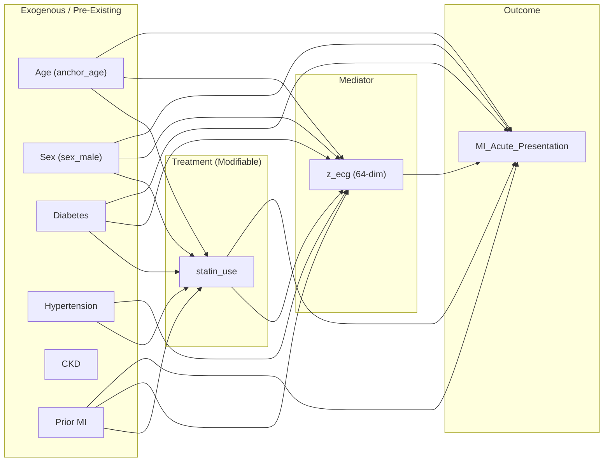

# 184-Column Master Dataset: Complete Construction Reference

> **Purpose**: Single source of truth for how the master dataset (`data/modeling/master/{train,validation,test}.parquet`) is built, covering all variable definitions for the upcoming causal DAG/analysis.

---

## 1. Scripts That Create the Master Dataset

The master dataset is built in **two sequential stages**:

### Stage 1 — Split & Preprocess ECG Features
**Script**: [`data/build_modeling_data.py`](file:///c:/Users/Acer/Desktop/Capstone/SCM/data/build_modeling_data.py)

```
data/processed/extracted_ecg_features_with_study_id.csv  ──┐
data/processed/final_ecg_cohorts_troponin.csv             ──┤──→ data/modeling/ecg_features/{train,val,test}.csv
MIMIC-IV patients.csv                                      ──┘    data/modeling/labels/{train,val,test}.csv
                                                                  data/modeling/demographics/demographics.csv
```

What it does:
1. Joins ECG features with cohort labels via `study_id`
2. **Excludes `MI_Post-Incident` rows** (≈31K ECGs taken >2h after MI onset)
3. Adds demographics (age, sex) from MIMIC-IV `patients.csv`
4. Subject-level stratified split (70/15/15, seed=42)
5. Preprocessing pipeline: feature removal → winsorization → Yeo-Johnson/log1p → scaling (all fitted on train only)
6. Exports split CSVs + parameters

### Stage 2 — Merge All Sources into Master Parquet
**Script**: [`src/features/build_master_dataset.py`](file:///c:/Users/Acer/Desktop/Capstone/SCM/src/features/build_master_dataset.py)

```
Labels (backbone)      ─┐
ECG Embeddings (64-dim)─┤  study_id
ECG Features (95 cols) ─┤
Comorbidities (4 cols) ─┤  hadm_id      ──→  master/{train,val,test}.parquet
Treatments (11 cols)   ─┤  hadm_id           (375,930 rows × 184 columns)
Demographics (2 cols)  ─┘  SubjectID
```

All joins are **LEFT JOIN** from the labels backbone (preserves every ECG record). Row count is asserted to be unchanged after each join.

### Upstream Cohort Creation (for context)
- **Cohort labels**: [`scripts/extract_cohort.py`](file:///c:/Users/Acer/Desktop/Capstone/SCM/scripts/extract_cohort.py) — creates `cohort_labels.csv` from `records_w_diag_icd10.csv` via DuckDB
- **Troponin-based labeling**: [`src/data/extraction/extract_troponin_cohorts.py`](file:///c:/Users/Acer/Desktop/Capstone/SCM/src/data/extraction/extract_troponin_cohorts.py) — creates `final_ecg_cohorts_troponin.csv`
- **Treatment extraction**: [`scripts/extract_cohort.py`](file:///c:/Users/Acer/Desktop/Capstone/SCM/scripts/extract_cohort.py#L131-L184) (Step 3) — creates `features_treatments.csv`
- **Comorbidities**: [`src/features/extract_comorbidities.py`](file:///c:/Users/Acer/Desktop/Capstone/SCM/src/features/extract_comorbidities.py) — creates `features_comorbidities.csv`

---

## 2. Label & Time Variable Definitions

### `is_MI` (boolean)

**Source**: [`scripts/extract_cohort.py`](file:///c:/Users/Acer/Desktop/Capstone/SCM/scripts/extract_cohort.py#L98-L113)

**Definition**: `True` if the admission's ICD-10 diagnosis list (`all_diag_all` from `records_w_diag_icd10.csv`) contains **any** of:
- **Type 1 MI**: `I21`, `I210`, `I2101`, `I2102`, `I2109`, `I211`, `I2111`, `I2119`, `I212`, `I2121`, `I2129`, `I213`, `I214`, `I219`
- **Type 2 MI**: `I21A1`
- **Subsequent MI**: `I22`, `I220`, `I221`, `I222`, `I228`, `I229`
- **Other MI**: `I21A`, `I21A9`
- **MI Complications**: `I23*` codes (confirms MI occurred even if no I21/I22 present)

**Granularity**: Admission-level (`hadm_id`). All ECGs within an MI admission share `is_MI = True`.

### `index_mi_time` (datetime, nullable)

**Source**: [`src/data/extraction/extract_troponin_cohorts.py`](file:///c:/Users/Acer/Desktop/Capstone/SCM/src/data/extraction/extract_troponin_cohorts.py#L26-L77)

**Definition**: The `charttime` of the **first troponin measurement classified as `Acute_MI`** within the admission. Classification logic:

```
Troponin Classification (per measurement):
  IF value > 2× URL AND (|Δ from prior| ≥ 20% OR |Δ to next| ≥ 20%)  → Acute_MI
  IF value > URL AND value ≤ 2× URL AND (|Δ from prior| ≥ 50% OR |Δ to next| ≥ 50%)  → Acute_MI
  IF value > URL (but fails delta criteria)  → Chronic_Injury
  ELSE  → Normal
```

Troponin thresholds (99th percentile URL):
| itemid | Assay | URL |
|--------|-------|-----|
| 51003 | cTnT | 0.014 ng/mL |
| 51002 | cTnI | 0.04 ng/mL |
| 52642 | cTnI (hs) | 0.04 ng/mL |

`index_mi_time = MIN(charttime)` among `Acute_MI` measurements, per `(hadm_id, subject_id)`.

**NULL for**: Controls (no MI admission) and MI admissions where no troponin met the `Acute_MI` criteria.

### `final_index_time` (datetime)

**Source**: [`extract_troponin_cohorts.py` L99](file:///c:/Users/Acer/Desktop/Capstone/SCM/src/data/extraction/extract_troponin_cohorts.py#L99)

**Definition**: `COALESCE(index_mi_time, anchor_time)` — uses the true troponin-derived MI time when available, otherwise falls back to the admission anchor time (ED registration or admit time).

### `time_diff_hours` (float64)

**Source**: [`extract_troponin_cohorts.py` L101](file:///c:/Users/Acer/Desktop/Capstone/SCM/src/data/extraction/extract_troponin_cohorts.py#L101)

**Definition**: `(ecg_time - final_index_time).total_seconds() / 3600`

- **For MI patients**: hours between ECG recording and MI onset (troponin-derived)
- **For controls**: hours between ECG and admission anchor time (NOT relative to any MI event — **use with caution**)

### `Label_Troponin` (string)

**Source**: [`extract_troponin_cohorts.py` L103-L115](file:///c:/Users/Acer/Desktop/Capstone/SCM/src/data/extraction/extract_troponin_cohorts.py#L103-L115)

**Definition** (using `np.select` with priority order):

| Label | Condition | Clinical Meaning |
|-------|-----------|------------------|
| `Control_Symptomatic` | `is_MI == False` | Patient had troponin tested but ALL below URL — cardiac rule-out |
| `MI_Acute_Presentation` | `is_MI == True` AND `-6 ≤ time_diff_hours ≤ +2` | ECG taken within the diagnostic window of acute MI |
| `MI_Pre-Incident` | `is_MI == True` AND `time_diff_hours < -6` | ECG from same admission but >6h before MI — baseline ECG |
| `MI_Post-Incident` | `is_MI == True` AND `time_diff_hours > +2` | ECG taken >2h after MI onset — **excluded from master dataset** |

> [!IMPORTANT]
> `MI_Post-Incident` is **excluded** from the master dataset ([`build_modeling_data.py` L53-L295](file:///c:/Users/Acer/Desktop/Capstone/SCM/data/build_modeling_data.py#L53)). The final master contains only 3 labels: `Control_Symptomatic` (362,372), `MI_Acute_Presentation` (7,604), `MI_Pre-Incident` (5,954).

---

## 3. Treatment Variable Definitions

**Source**: [`scripts/extract_cohort.py` Step 3 (L131-L184)](file:///c:/Users/Acer/Desktop/Capstone/SCM/scripts/extract_cohort.py#L131-L184)

### Temporal Windows

All temporal windows are defined relative to the admission's **anchor time** and **discharge time**:

| Window | Period | Database Reference |
|--------|--------|-------------------|
| `before` | `window_before_start` → `anchor_time` | ≈7 days before admission (bounded by prior discharge if another admission exists) |
| `during` | `anchor_time` → `dischtime` | During the hospital admission |
| `after` | `dischtime` → `window_after_end` | ≈7 days after discharge (bounded by next admission if one exists) |

> [!WARNING]
> The `before` window captures **recent INPATIENT prescriptions only** (from MIMIC-IV `prescriptions.csv`), not true outpatient baselines. This is a known limitation acknowledged in the extraction script ([L132](file:///c:/Users/Acer/Desktop/Capstone/SCM/scripts/extract_cohort.py#L132)).

### Medication Variables (from `prescriptions.csv`)

| Variable | Drug Match Pattern | Window | Source Table |
|----------|-------------------|--------|-------------|
| `aspirin_before` | `LIKE '%aspirin%'` | Before | `hosp/prescriptions.csv` |
| `aspirin_during` | `LIKE '%aspirin%'` | During | `hosp/prescriptions.csv` |
| `statin_before` | `LIKE '%vastatin%'` | Before | `hosp/prescriptions.csv` |
| `statin_during` | `LIKE '%vastatin%'` | During | `hosp/prescriptions.csv` |
| `statin_after` | `LIKE '%vastatin%'` | After | `hosp/prescriptions.csv` |
| `beta_blocker_before` | `LIKE '%olol%' OR LIKE '%carvedilol%'` | Before | `hosp/prescriptions.csv` |
| `beta_blocker_during` | `LIKE '%olol%' OR LIKE '%carvedilol%'` | During | `hosp/prescriptions.csv` |
| `acei_before` | `LIKE '%pril%'` | Before | `hosp/prescriptions.csv` |
| `acei_during` | `LIKE '%pril%'` | During | `hosp/prescriptions.csv` |

All are **binary (0/1)**: `MAX(CASE WHEN ... THEN 1 ELSE 0 END)` aggregated per `hadm_id`.

### Procedure Variables (from ICU tables)

| Variable | Source Table | itemid Filter | Window |
|----------|------------|---------------|--------|
| `vasopressor_during` | `icu/inputevents.csv` | 221906 (Norepinephrine), 221289 (Epinephrine), 221662 (Dopamine), 222315 (Vasopressin), 221653 (Phenylephrine) | During |
| `mech_vent_during` | `icu/procedureevents.csv` | 225792 (Invasive Vent), 225794 (Non-Invasive Vent), 224385 (Intubation) | During |

Both are **binary (0/1)**, `COALESCE`d to 0 if no ICU data exists.

---

## 4. How ECG Features & z_ecg Embeddings Merge into the Master

### 95 ECG Morphological Features

**Original extraction**: ECG-Deli MATLAB toolbox ([`extract_ecg_features.m`](file:///c:/Users/Acer/Desktop/Capstone/SCM/extract_ecg_features.m)) → `extracted_ecg_features_with_study_id.csv` (192 raw features)

**Feature reduction** (192 → 160 → 95 — completed and verified, not re-audited):
1. 192 raw features from ECG-Deli
2. → 160 after initial filtering (32 near-zero-variance / redundant removed)
3. → 95 after regex-based removal of `ST_Elev_*_iqr` and non-global `_count` columns

**Merge key**: `study_id` (LEFT JOIN from labels backbone)

**Preprocessing in Stage 1** ([`build_modeling_data.py`](file:///c:/Users/Acer/Desktop/Capstone/SCM/data/build_modeling_data.py#L389-L423)):
1. Winsorization (group-specific quantile bounds, fitted on train)
2. Yeo-Johnson transform (amplitude_mean, st_elev_mean groups) and log1p (IQR group)
3. Scaling (StandardScaler for global/count, RobustScaler for amplitude/iqr/st_elev)

### 64 z_ecg VAE Embeddings

**Source**: [`src/models/extract_embeddings.py`](file:///c:/Users/Acer/Desktop/Capstone/SCM/src/models/extract_embeddings.py) — Conv1D β-VAE encoder applied to raw 12-lead ECG waveforms (12 × 5000 samples at 500 Hz).

**Architecture**: 82M parameter Conv1D β-VAE, trained unsupervised for 109 epochs. The encoder's **latent mean vector** (μ, not sampled z) is used as the embedding.

**Output**: `data/modeling/ecg_embeddings/{train,validation,test}.csv` — columns: `study_id, SubjectID, z_ecg_1, ..., z_ecg_64`

**Merge key**: `study_id` (LEFT JOIN from labels backbone in Stage 2)

**Not preprocessed further** — the VAE already produces normalized latent representations.

---

## 5. Final Schema / Data Dictionary (184 columns)

### Identifiers (3)
| Column | Type | Join Key | Description |
|--------|------|----------|-------------|
| `study_id` | int64 | ECG-level | Unique ECG study identifier |
| `SubjectID` | int64 | Patient-level | Patient identifier |
| `hadm_id` | int64 | Admission-level | Hospital admission identifier |

### Labels (2)
| Column | Type | Description |
|--------|------|-------------|
| `Label_Troponin` | str | `Control_Symptomatic`, `MI_Pre-Incident`, `MI_Acute_Presentation` |
| `is_MI` | bool | Binary MI flag (ICD-10 based) |

### Time (3)
| Column | Type | Description |
|--------|------|-------------|
| `ecg_time` | str | Timestamp of ECG recording |
| `index_mi_time` | str | Timestamp of MI event (NULL for controls — 87% missing, expected) |
| `time_diff_hours` | float64 | Hours between ECG and MI event / anchor time |

### ECG Embeddings (64)
| Columns | Type | Description |
|---------|------|-------------|
| `z_ecg_1` ... `z_ecg_64` | float64 | 64-dim VAE latent mean of raw 12-lead ECG |

### ECG Features (95)
| Category | Example Columns | Count |
|----------|-----------------|-------|
| Global timing | `QRS_Dur_Global`, `RR_Mean_Global`, `*_iqr` variants, `QRS_Dur_Global_count` | 5 |
| Amplitudes (Q, R, T per lead + S_V1-V3) | `Q_Amp_I`, `R_Amp_V4`, `T_Amp_aVF`, `S_Amp_V1` | 39 |
| IQR variants | `Q_Amp_I_iqr`, `R_Amp_V4_iqr`, `T_Amp_aVF_iqr` | 24 |
| ST elevation | `ST_Elev_I` ... `ST_Elev_V6` | 12 |
| Global IQR | `QRS_Dur_Global_iqr`, `RR_Mean_Global_iqr`, `S_Amp_V1_iqr` ... `S_Amp_V3_iqr` | 5 |

### Comorbidities (4)
| Column | Type | Description |
|--------|------|-------------|
| `diabetes` | float64 | ICD-coded diabetes from **prior** admissions only |
| `hypertension` | float64 | ICD-coded hypertension from **prior** admissions only |
| `ckd` | float64 | ICD-coded chronic kidney disease from **prior** admissions only |
| `prior_mi` | float64 | Had MI (ICD I21/I22 or ICD-9 410/412) in a **previous** admission |

### Treatments (11)
| Column | Type | Window | Description |
|--------|------|--------|-------------|
| `statin_before` | float64 | Before | Pre-admission statin prescription |
| `statin_during` | float64 | During | In-hospital statin prescription |
| `statin_after` | float64 | After | Post-discharge statin prescription |
| `beta_blocker_before` | float64 | Before | Beta-blocker prescription |
| `beta_blocker_during` | float64 | During | Beta-blocker prescription |
| `acei_before` | float64 | Before | ACE inhibitor prescription |
| `acei_during` | float64 | During | ACE inhibitor prescription |
| `aspirin_before` | float64 | Before | Aspirin prescription |
| `aspirin_during` | float64 | During | Aspirin prescription |
| `vasopressor_during` | float64 | During | Vasopressor administration (ICU) |
| `mech_vent_during` | float64 | During | Mechanical ventilation (ICU) |

### Demographics (2)
| Column | Type | Description |
|--------|------|-------------|
| `anchor_age` | float64 | Patient age (MIMIC-IV anchor_age, not true admission age) |
| `sex_male` | int64 | Binary sex indicator (1 = Male) |

### Missingness
| Column | Missing Rate | Explanation |
|--------|-------------|-------------|
| `index_mi_time` | 87.1% | Expected — only MI patients have an MI event time |
| All other columns | 0% | Perfect 100% coverage |

---

## 6. Established Clinical/Domain Assumptions for the DAG

These are the causal edges **already specified** in the pipeline ([Phase I — DAG Design](file:///c:/Users/Acer/Desktop/Capstone/SCM/docs/pipeline.txt)):

### DAG Structure (from Pipeline Phase I.1)



### Specified Causal Edges & Clinical Rationale

| Edge | Rationale |
|------|-----------|
| **Age → MI** | Age increases plaque instability, thrombotic risk |
| **Sex → MI** | Hormonal differences in coronary artery disease |
| **Diabetes → MI** | Endothelial dysfunction, chronic inflammation |
| **Hypertension → MI** | Left ventricular hypertrophy, vascular damage |
| **Prior MI → MI** | Scarring, reduced EF, arrhythmia substrate |
| **Age/Sex/DM/HTN/Prior MI → statin_use** | Older, diabetic, hypertensive, and post-MI patients are more likely to be prescribed statins (confounding by indication) |
| **Age/Sex/DM/HTN/Prior MI → z_ecg** | All alter resting ECG morphology (LVH, Q-waves, conduction delays) |
| **statin_use → MI** | Statins stabilize plaques, reduce MI risk (the causal effect we want to estimate) |
| **statin_use → z_ecg** | Possible pleiotropic effects on cardiac electrophysiology |
| **z_ecg → MI** | Acute ECG changes (ST elevation, T-wave inversion) indicate active ischemia |
| **Prior MI → z_ecg (DUAL path)** | Prior MI physically alters ECG (old Q-waves, reduced R-wave progression) AND directly increases MI risk (reduced cardiac reserve) |

### Key Structural Assumptions

1. **Primary treatment variable**: `statin_use` (binary, precisely measured, clinically actionable) — recommended over LDL due to measurement error in 12-month-window labs
2. **z_ecg is a mediator**, not a confounder — it sits on the causal path between risk factors and MI
3. **Comorbidities are from PRIOR admissions only** — prevents reverse causality (current admission diagnosis leaking)
4. **Troponin is NEVER used as a feature** — it is used exclusively for labeling to prevent circular prediction
5. **`_during` treatments** are potential mediators/colliders (not confounders) since they happen concurrently with or after MI onset
6. **`_before` treatments** are the appropriate treatment variables for causal estimation (pre-exposure)
7. **Labs and vitals were dropped** from the master dataset due to <1% coverage — not available for the DAG

### Backdoor Adjustment Set (from Phase I.4)

For the **Total Effect of statin_use → MI_Acute_Presentation**:
- Adjustment set: `{Age, Sex, Diabetes, Hypertension, CKD, Prior MI}`

For the **Effect of z_ecg → MI_Acute_Presentation**:
- Adjustment set: `{Age, Sex, Diabetes, Hypertension, Prior MI, statin_use}`

### Variables NOT in the Pipeline DAG (but available)

The pipeline DAG was designed when only `statin_use` was the treatment variable. The master dataset now contains **11 treatment variables** and additional confounders that were not in the original Phase I specification:

| Available but Not in Original DAG | Potential DAG Role |
|----------------------------------|-------------------|
| `aspirin_before/during` | Additional treatment → MI |
| `beta_blocker_before/during` | Additional treatment → MI |
| `acei_before/during` | Additional treatment → MI |
| `vasopressor_during` | Severity marker / mediator (during MI) |
| `mech_vent_during` | Severity marker / mediator (during MI) |
| `statin_after` | Post-treatment outcome (NOT a cause of MI) |
| `ckd` | Confounder (affects troponin baseline, ECG morphology, and MI risk) |
| 95 ECG morphological features | Potential substitutes or supplements to z_ecg in the DAG |

> [!IMPORTANT]
> **Decision needed**: The original DAG uses `z_ecg` (64-dim VAE embedding) as the ECG node. The 95 morphological features are available as an interpretable alternative or supplement. Choose based on whether interpretability or representation richness is prioritized for the causal analysis.
