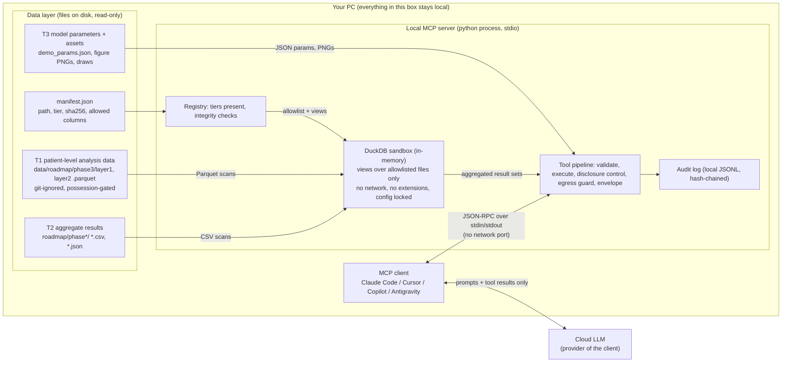
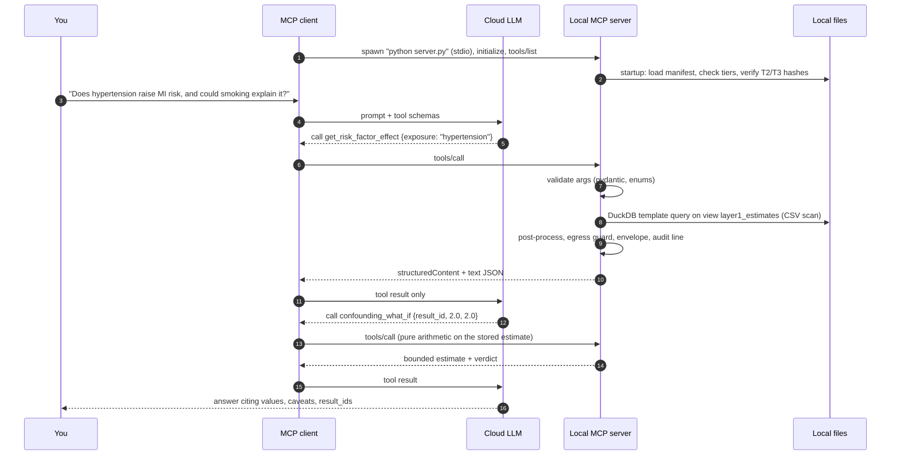

# Local MCP Server — Revised Design (replaces Phase O of `docs/pipeline.md`)

**Status:** design v1.1, 2026-11-23 · **Runtime:** project env (`Capstone/cuda_env`, Python 3.12.10), `mcp` 1.26.0
(FastMCP with structured output), pydantic 2.12, **DuckDB 1.4.1 as the query engine**, numpy. No new
dependencies are needed.
**Scope:** one local MCP server that serves the causal-MI roadmap results to any MCP-compatible AI client
(Claude Code, Cursor, GitHub Copilot in VS Code, Antigravity, Claude Desktop). The client's cloud LLM does
the reasoning. The server runs on this PC and reads only files on this PC.

---

## 1. Design principles

1. **Local compute, cloud reasoning.** All data access and arithmetic happen in a local process. The LLM
   only ever receives the JSON a tool returns.
2. **Data possession is the access model.** A tool works only if the files it needs are on this machine. No
   files means no answer, never a guess.
3. **Results, not rows.** Tools return pre-computed estimates, aggregates with small-cell suppression, or
   model outputs for user-supplied inputs. No tool can return a patient-level row, an identifier, a file, or
   arbitrary query results.
4. **Standard MCP only.** stdio transport, JSON Schema inputs, structured outputs with a text fallback, and
   standard tool annotations. The same server binary works in every client through its usual JSON config.
5. **The server enforces the honesty rules.** Caveats, assumptions and plain-language summaries come from the
   server, so a careless prompt or a different LLM cannot drop them.
6. **One query engine: DuckDB, sandboxed.** Every data-backed tool queries Parquet and CSV files through an
   in-memory DuckDB connection that can read only manifest-listed files, has no network or extension access,
   and has its configuration locked (Section 3.4). Queries are reviewed SQL templates; the LLM never writes SQL.

---

## 2. What changed from the October Phase O

| Oct 2026 Phase O | Now | Why |
|---|---|---|
| `query_cohort_statistics` (legacy master) | `cohort_summary` | Reads the roadmap datasets (the legacy master has troponin-timed labels, dropped post-onset ECGs and swapped aVL/aVF) and adds disclosure control |
| `get_baseline_results` | dropped | The baseline "clinical" inputs include `statin_after`, `*_during`, `vasopressor_during`, `mech_vent_during` (post-ECG information) |
| `predict_mi_risk` | dropped → `explain_ecg` | Needs inputs unavailable at prediction time; an MI probability contradicts roadmap decision W1 |
| `get_causal_estimate` (statins etc.) | `get_risk_factor_effect`, `get_ecg_effect`, `robustness_card` | The treatment branch was closed (hospital medication records could not fix treatment timing); the roadmap estimates exist |
| `generate_counterfactual` (statin=1 in a classifier) | `explain_ecg` (profile mode) | A classifier is not a structural model; the MI→ECG model-implied comparison is valid and already tested |
| `visualize_risk_landscape` | `render_figure` | CATE plots never existed; the Phase 6/7 figures do |
| — | `study_overview`, `describe_variable`, `get_subgroup_effects`, `confounding_what_if`, `trace_claim`, `server_status` | Grounding, sensitivity, provenance and self-checks |

The O.3 safeguards (read-only, no arbitrary code, mandatory disclaimers, minimum subgroup size, bounds
checks, audit logging) are all kept; see Section 4. The O.4 LLM rules are enforced through the response
envelope instead of a system prompt.

---

## 3. End-to-end pipeline

### 3.1 Architecture



The only things that leave the PC are what the client sends to its LLM: your chat messages and the JSON
tool results. Raw MIMIC tables (`Capstone/data/raw`, `mimic_database.duckdb`) are not in the server's
manifest, so they are outside the DuckDB allowlist and no query can reach them. This was tested; see 3.4.

### 3.2 Data tiers

| Tier | Contents | Where | Who can use it | What can leave the PC |
|---|---|---|---|---|
| T0 raw | MIMIC-IV CSVs, ECG waveforms, DuckDB | `Capstone/data/raw` | Not registered with the server | Nothing |
| T1 patient-level | Layer 1 / Layer 2 analysis datasets | `data/roadmap/phase3/` (git-ignored) | Only machines that hold the files | Aggregates after small-cell suppression and rounding |
| T2 aggregate results | Estimates, sensitivity tables, claim map | `roadmap/phase*/` | Anyone with the repo (already public) | Values as stored |
| T3 parameters & assets | Explainer parameters, bootstrap coefficient draws, figure PNGs | `roadmap/phase9_demo/`, `local_mcp/assets/` | Anyone with the repo | Model outputs for user-supplied inputs |

Possession gating protects T1, the only patient-level tier. T2 and T3 tools also work on a fresh clone,
which is acceptable because that content is already published.

### 3.3 Request lifecycle



| Step | What happens | Guard |
|---|---|---|
| 1 Spawn | The client starts the server as a child process. JSON-RPC runs over stdin/stdout. | No listening port. A network-socket guard makes any outbound connection attempt raise an error. |
| 2 Startup | Registry reads `manifest.json`, marks each tier present or absent, and verifies SHA-256 for T2/T3 (small files); for T1 it checks size and modified time (full hash on `server_status(verify_full=true)`). It then opens the DuckDB sandbox: allowlist = manifest paths that are present, one view per artifact (`layer1`, `layer2`, `layer1_estimates`, …), then external access off and configuration locked. A warm-up query plans each template. | A hash mismatch disables the affected tools with `INTEGRITY_MISMATCH`. Absent files are simply not allowlisted. |
| 3 Validate | Arguments are parsed by pydantic models generated from the same schemas the client saw. Enums everywhere; numbers have bounds. | No free text reaches file paths, SQL or code. Unknown names return the valid values. |
| 4 Resolve data | The tool asks the registry whether its views exist. | Missing tier → `DATA_NOT_PRESENT`. |
| 5 Execute | The tool runs a **named SQL template** from `local_mcp/sql/` against the views. Column and grouping identifiers come from a fixed enum → SQL mapping; values are bound as typed parameters (`?::TINYINT`). DuckDB reads only the columns a query names (Parquet projection), so ECG features, latents, timestamps and identifiers are never loaded unless a template needs them, and T1 aggregation happens inside DuckDB, so patient rows never enter Python. Non-query work (bias arithmetic, the ECG explainer, figures) is plain numpy/JSON. | Read-only views; no LLM-authored SQL; deterministic (fixed-seed bootstrap draws only). |
| 6 Disclosure control | `cohort_summary` only: cells with n < 11 are suppressed; counts are rounded to the nearest 5; complementary suppression stops back-calculation; at most 2 stratification variables. | `suppressed_cells` reported in the envelope. |
| 7 Egress guard | Every response is scanned before it leaves: denylisted keys (`subject_id`, `hadm_id`, `study_id`, `ecg_time`, …), integers ≥ 10,000,000 (MIMIC identifier range), shifted dates (years 2100–2210), payload > 32 KB, tables > 60 rows. | Any hit blocks the response (`DISCLOSURE_BLOCKED`, reporting check codes, never values) and logs locally. This is a second line of defence; tools are written not to produce these. As built (M4, `egress.py`): applied in the audited wrapper to every result and to error text (which can echo inputs); images are excluded because they are fixed, hash-verified assets. Largest real payload: 8.6 KB. |
| 8 Envelope | Adds `summary`, `caveats`, `assumptions`, `provenance` (artifact paths + hashes), `disclosure`. | The LLM receives the interpretation and caveats with every number. |
| 9 Audit | One hash-chained JSONL line per call: time, tool, arguments (user-supplied ECG values hashed), output hash, duration, outcome. Stored under `data/local_mcp/` (git-ignored). | Local only; tamper-evident. |
| 10 Return | `structuredContent` (matches `outputSchema`) plus the same JSON as text for clients that ignore structured output. Errors are returned as tool results with `isError: true`, so the LLM can correct itself. | — |

### 3.4 Query engine: the DuckDB sandbox

One in-memory DuckDB connection per server process. No `.duckdb` database file is created or attached, so
several clients can each run their own server without file locks. The settings were tested on this PC with
DuckDB 1.4.1.

```python
con = duckdb.connect(":memory:", config={
    "autoinstall_known_extensions": False,   # never download extensions
    "autoload_known_extensions": False,
    "threads": 4, "memory_limit": "2GB",     # keep the laptop responsive
})
# Order matters: allowed_paths can only be set after start, and before external access is disabled.
con.execute(f"SET allowed_paths = {sql_list(present)}")   # literal list of manifest files present on disk
                                                      # (SET takes no bound parameters; paths come from the
                                                      #  manifest, never from tool input)
con.execute("SET enable_external_access = false")     # nothing outside the allowlist, no network
for name, path, reader in registry.views():          # e.g. CREATE VIEW layer1 AS SELECT * FROM read_parquet(...)
    con.execute(f"CREATE VIEW {name} AS SELECT * FROM {reader}('{path}')")
con.execute("SET lock_configuration = true")         # the above cannot be undone by any later statement
```

**Verified behaviour** (test on 2026-11-23, this repo):

| Attempt | Result |
|---|---|
| Grouped aggregate over allowlisted `layer1.parquet` (430,852 rows) | Allowed, ~0.01–0.06 s |
| Filter on an allowlisted CSV of estimates | Allowed, ~0.03 s |
| Read a local file that is not allowlisted (`layer2.parquet` in that test) | `PermissionException` |
| `ATTACH` the raw `mimic_database.duckdb` | `PermissionException` |
| Read an `https://` URL | `PermissionException` |
| `INSTALL` / `LOAD` an extension (e.g. `httpfs`) | `PermissionException` |
| `COPY ... TO` a file | `PermissionException`, no file written |
| `SET enable_external_access = true` after locking | `InvalidInputException` |

**Rules for the SQL layer**
- **Templates, not generated SQL.** Each query lives in `local_mcp/sql/<tool>__<name>.sql`, is hashed in
  the manifest like any artifact, and has a unit test. The LLM can only choose enum values.
- **Identifiers from a whitelist, values as parameters.** `stratify_by=["age_band","sex"]` maps to fixed
  SQL fragments (`CASE WHEN age < 45 THEN '18-44' …`, `sex_male`); numbers and enum values are bound as
  typed parameters. Typed parameters run in under 10 ms; untyped ones cost about 0.5 s to plan the first
  time, hence the warm-up at startup.
- **Aggregate in the database.** T1 templates always end in `GROUP BY` with `count(*)`; there is no T1
  template without aggregation, so patient rows never reach Python. As built (M3), suppression runs in Python
  on the aggregated cells, because complementary suppression must know where the small cells are: cells under
  11 are hidden, then the smallest other cell in any table line holding exactly one hidden cell, repeated until
  no line isolates a hidden cell; visible counts are rounded to the nearest 5.
- **Snapshots and freshness (as built in M2).** Small CSV results are loaded into in-memory tables right
  after their hashes are verified, and JSON/SQL files are cached at the same moment, so tools always use exactly
  the verified content. Only Parquet views are read lazily; before each query the registry re-checks those
  files' size and modified time and returns `INTEGRITY_MISMATCH` if they changed. `server_status` reports any
  on-disk change to any file. (Checking every file before every query cost ~0.3 s per overview on Windows.)
- **Derived views.** `views__*.sql` templates (macros, `l1_effects`, `l1_checks`, `l2_effects`, `l2_class`,
  `l2_subgroups`) give the tools three clean interfaces over the 24 result tables.

**Which tools use DuckDB:** every tool that reads a table — `study_overview`, `describe_variable`
(variable dictionary CSV), `get_risk_factor_effect`, `get_ecg_effect`, `get_subgroup_effects`,
`robustness_card` (joins across the Phase 5–7 tables in one query), `confounding_what_if` (fetches the stored
estimate), `cohort_summary` (T1), `trace_claim` (claim map), and `server_status` (row counts per view).
`explain_ecg` and `render_figure` need no queries: they use `demo_params.json`, stored bootstrap draws and
PNGs.

---

## 4. Toolset

Twelve tools in four groups. All are annotated `readOnlyHint: true`, `idempotentHint: true` and
`openWorldHint: false` (they never touch the outside world). Names are snake_case ASCII ≤ 64 characters,
which every client accepts.

| # | Tool | Group | Tier | Engine | Purpose |
|---|---|---|---|---|---|
| 1 | `study_overview` | Orientation | T2 | DuckDB | One call that grounds the LLM: question, design, cohort flow, headline results and their IDs |
| 2 | `describe_variable` | Orientation | T2 | DuckDB | Definitions, ICD code lists, units and causal role of any variable |
| 3 | `get_risk_factor_effect` | Results | T2 | DuckDB | Layer 1 risk ratios with E-values and verdicts |
| 4 | `get_ecg_effect` | Results | T2 | DuckDB | Layer 2 effects of MI on ECG measures (and the latent audit) for any analysis set |
| 5 | `get_subgroup_effects` | Results | T2 | DuckDB | Age and sex subgroups with interaction tests |
| 6 | `robustness_card` | Results | T2 | DuckDB (multi-table join) | Every stress test for one result on one card, with pass/fail |
| 7 | `confounding_what_if` | Computation | T2 | DuckDB + arithmetic | Live bias analysis: "how strong would a hidden confounder have to be?" |
| 8 | `cohort_summary` | Computation | **T1** | DuckDB (aggregate-only) | Disclosure-controlled descriptive statistics from the patient-level data |
| 9 | `explain_ecg` | Computation | T3 | numpy | Observed vs expected-without-MI comparison for a user-supplied or synthetic ECG |
| 10 | `render_figure` | Presentation | T3 | file | Study figures as PNG plus their data table |
| 11 | `trace_claim` | Trust | T2 | DuckDB | Any manuscript claim → evidence files, hashes, assumptions |
| 12 | `server_status` | Trust | all | DuckDB + registry | Integrity, tiers present, sandbox state, versions |

### 4.1 Shared conventions

**Result IDs** let tools chain: `L1:<exposure>:<primary|alternative>` (e.g. `L1:hypertension:primary`) and
`L2:<measure>` (e.g. `L2:ST_lateral_mean`). Every result carries its ID.

**Response envelope** (all tools):

```json
{
  "ok": true,
  "tool": "get_risk_factor_effect",
  "result": { "...tool-specific..." : "..." },
  "summary": "One plain-language sentence a clinician could read.",
  "caveats": ["Risk-factor contrast among hospitalized adults, not a treatment effect."],
  "assumptions": [{"id": "A5", "text": "No unmeasured common cause of the condition and MI (bounded by E-value)."}],
  "provenance": {
    "artifacts": [{"path": "roadmap/phase5_estimation/LAYER1_ESTIMATES.csv", "sha256": "…"}],
    "manifest_version": "…", "phase": 5
  },
  "disclosure": {"tier": "aggregate", "suppressed_cells": 0}
}
```

**Error envelope** (`isError: true`), designed so the LLM can recover in one retry:

```json
{
  "ok": false,
  "error": {
    "code": "INVALID_ARGUMENT",
    "message": "Unknown measure 'lateral ST'.",
    "did_you_mean": ["ST_lateral_mean"],
    "valid_values_tool": "describe_variable"
  }
}
```

Error codes: `INVALID_ARGUMENT`, `DATA_NOT_PRESENT`, `INTEGRITY_MISMATCH`, `DISCLOSURE_BLOCKED`,
`NOT_SUPPORTED` (e.g. a probability request), `INTERNAL`. FastMCP prefixes the text with
"Error executing tool <name>: " before the JSON body.

### 4.2 Tool specifications

Input schemas are shown in compact form; the server generates full JSON Schema from pydantic models, with
enums, bounds and defaults. All example values are real outputs from the roadmap phases unless marked
*illustrative*.

---

#### 1. `study_overview`

Call this first; its description tells the LLM so.
**Input:** `{}`
**Returns:**
```json
{
  "question": "Two-layer causal model: chronic conditions -> acute MI; acute MI -> ECG",
  "data": "MIMIC-IV v2.2 + MIMIC-IV-ECG v1.0 (single centre, hospitalized adults)",
  "cohort": {"layer1_admissions": 430852, "layer1_acute_mi": 11222,
             "layer2_primary_admissions": 188808, "layer2_after_onset_mi": 5643},
  "estimands": {"layer1": "ATE in overlap region (risk ratio)", "layer2": "ATT in control-SD units"},
  "headline_results": [
    {"result_id": "L1:hypertension:primary", "rr": 1.44, "verdict": "survives"},
    {"result_id": "L1:ckd:primary", "rr": 1.34, "verdict": "fragile"},
    {"result_id": "L2:ST_lateral_mean", "att_sd": -0.36, "verdict": "survives"}
  ],
  "tiers_present": {"T1": true, "T2": true, "T3": true},
  "suggested_next_tools": ["get_risk_factor_effect", "get_ecg_effect", "robustness_card"]
}
```

#### 2. `describe_variable`

**Input:** `{ "name": string (fuzzy-matched against the data dictionary) }`
**Returns:** name, definition, ICD-9/ICD-10 code lists (from `roadmap/definitions.py`), units, layer, causal
role (`exposure | outcome | covariate | effect_modifier | forbidden`), source phase, and `did_you_mean`
when the match is uncertain. Example: `acute_mi` → "ICD-9 410.x0/x1 or ICD-10 I21/I22 at the current
admission; 410.x2 excluded", role `exposure (Layer 2) / outcome (Layer 1)`.

#### 3. `get_risk_factor_effect`

**Input:**
```json
{
  "exposure": "diabetes | hypertension | ckd | prior_mi",
  "adjustment": "primary | alternative            (default primary)",
  "estimand": "ate_overlap | att                  (default ate_overlap)"
}
```
**Returns** (`exposure=hypertension`):
```json
{
  "result_id": "L1:hypertension:primary",
  "adjusted_for": ["age (spline)", "sex", "diabetes"],
  "n_admissions": 430852, "n_exposed": 245874,
  "risk_ratio": 1.44, "rr_ci95": [1.35, 1.53],
  "risk_difference_pp": 0.89, "rd_ci95_pp": [0.74, 1.02], "crude_rd_pp": 2.74,
  "att_risk_ratio": 1.38,
  "e_value": {"point": 2.24, "ci_limit": 2.03},
  "identification": "Valid under the revised graph (diabetes -> hypertension) and all variants except hypertension -> diabetes",
  "phase7_verdict": "survives"
}
```
For diabetes, `identification` says the total effect is not identified and the server returns both sets as
a bracket (1.67 and 1.54). `prior_mi` is flagged as descriptive.

#### 4. `get_ecg_effect`

**Input** (exactly one of `measure` or `group`):
```json
{
  "measure": "string, e.g. ST_Elev_I | ST_lateral_mean | z_ecg_57 (fuzzy-matched)",
  "group": "ST | T | Q | R | S | QRS | RR | composite | latent",
  "analysis_set": "primary | nstemi | chest_pain_comparator | after_strict | no_type2 | first_ecg_has_features | selection_weighted | bmi_adjusted | broad_codes | negative_control   (default primary)",
  "units": "sd | raw   (default sd)",
  "top_k": "integer 1-20 (default 10, group mode only, sorted by |effect|)"
}
```
**Returns** (`measure=ST_Elev_I`):
```json
{
  "result_id": "L2:ST_Elev_I", "analysis_set": "primary",
  "att_sd": -0.361, "ci95_sd": [-0.397, -0.327], "att_raw": -0.017, "raw_units": "mV",
  "q_value": "<0.001",
  "crude_sd": -0.475, "adjusted_share_of_crude": 0.76,
  "classification": "MI-attributable",
  "robust": true,
  "robust_checks": {"nstemi_same_sign": true, "negative_control_ratio": 0.31}
}
```
Group mode returns up to `top_k` rows in the same shape plus a group summary (features, number significant,
mean |effect|). `group=latent` returns the latent audit fields (`r2_baseline`, `delta_r2_mi`,
`top_handcrafted_feature`) and the conclusion that latents carry no MI information beyond handcrafted
features. QRS duration is returned with `"validated": false` (machine QRS disagrees).

#### 5. `get_subgroup_effects`

**Input:** `{ "result_id": string, "modifier": "age | sex" }`
**Returns:** one row per subgroup (`age_lt65 / age_ge65` or `female / male`) with n, cases, estimate and CI,
plus the interaction difference, p-value and BH q-value (Layer 2: across the 16 robust measures). Example
for `L2:ST_lateral_mean`, `modifier=age`: −0.29 SD (< 65) vs −0.40 SD (≥ 65), difference −0.11, q 0.022.
Subgroups with fewer than 100 cases are refused (`DISCLOSURE_BLOCKED`), as in the original O.3 rule.

#### 6. `robustness_card` ★

The single most persuasive demo call: one result against every stress test, with pre-declared pass rules.
**Input:** `{ "result_id": string }`
**Returns** (`L2:ST_lateral_mean`):
```json
{
  "result_id": "L2:ST_lateral_mean",
  "primary": {"att_sd": -0.36, "ci95": [-0.40, -0.33]},
  "checks": [
    {"check": "NSTEMI only (no ST-elevation coding)", "att_sd": -0.50, "same_direction": true},
    {"check": "Chest-pain comparator",               "att_sd": -0.49, "same_direction": true},
    {"check": "ECG-selection weighted",               "att_sd": -0.36, "same_direction": true},
    {"check": "After-strict timing",                  "att_sd": -0.31, "same_direction": true},
    {"check": "Type 2 MI excluded",                   "att_sd": -0.36, "same_direction": true},
    {"check": "First ECG has features",               "att_sd": -0.38, "same_direction": true},
    {"check": "BMI adjusted (same rows)",             "att_sd": -0.44, "same_direction": true},
    {"check": "Broad MI codes",                       "att_sd": -0.34, "same_direction": true},
    {"check": "Subgroups (<65, >=65, F, M)",          "att_sd": [-0.29, -0.40, -0.36, -0.36], "same_direction": true},
    {"check": "Negative control (ECG before a later MI)", "att_sd": -0.10, "ratio_to_primary": 0.29, "rule": "ratio < 0.5", "pass": true},
    {"check": "Unmeasured confounding", "e_value": 2.13, "e_value_ci": 2.03}
  ],
  "verdict": "survives",
  "what_would_overturn_it": "A confounder associated with both MI and lateral ST level at RR >= 2.03 beyond age, sex and comorbidities"
}
```
For `L1:ckd:primary` the card shows the failure plainly: principal-diagnosis MI RR 0.97 (0.91–1.05) →
`verdict: "fragile"`.

#### 7. `confounding_what_if` ★

Interactive bias analysis (Ding & VanderWeele bounding factor) on stored estimates. Pure arithmetic, no data.
**Input:**
```json
{
  "result_id": "string",
  "rr_confounder_exposure": "number 1.0-10.0",
  "rr_confounder_outcome": "number 1.0-10.0"
}
```
**Returns** (`L1:hypertension:primary`, 2.0 / 2.0):
```json
{
  "bounding_factor": 1.33,
  "observed_rr": 1.44, "worst_case_rr": 1.08,
  "observed_ci_lower": 1.35, "worst_case_ci_lower": 1.01,
  "explained_away": false,
  "e_value_reference": {"point": 2.24, "ci_limit": 2.03},
  "benchmarks": [{"measured_factor": "diabetes", "rr_with_mi": 1.67}],
  "method": "B = RRue*RRud/(RRue+RRud-1); RR_true >= RR_obs/B"
}
```
With 2.5 / 2.5 the worst case falls to 0.92 → `explained_away: true`. For Layer 2 results the server converts
the SD effect with RR ≈ exp(0.91·|d|) and back, and says so in `method`. Built-in check: entering the E-value
for both parameters must return a worst case of 1.00.

#### 8. `cohort_summary` (T1, possession-gated)

Replaces `query_cohort_statistics`. Only fixed dimensions and metrics; no filters, no free text. The query
runs as one DuckDB template over the `layer1` or `layer2` view, grouped and counted inside DuckDB, so no
patient row reaches Python. Sketch (`sql/cohort_summary__grouped.sql`; `{dims}` and `{metrics}` are filled
only from the whitelist mapping):

```sql
SELECT {dims}, count(*) AS n_admissions, count(DISTINCT subject_id) AS n_patients, {metrics}
FROM layer1
GROUP BY ALL
HAVING count(*) >= 11
```
**Input:**
```json
{
  "layer": "layer1 | layer2_primary",
  "stratify_by": "array, 0-2 of: acute_mi | sex | age_band | diabetes | hypertension | ckd | prior_mi | mi_subtype | timing_class",
  "metrics": "array of: n_admissions | n_patients | age_mean | age_sd | pct_male | pct_diabetes | pct_hypertension | pct_ckd | pct_prior_mi | pct_acute_mi"
}
```
`age_band` = 18–44, 45–64, 65–79, 80+. `mi_subtype` and `timing_class` are valid only within MI admissions.
**Returns** (`layer1`, `stratify_by=["acute_mi"]`):
```json
{
  "rows": [
    {"acute_mi": 1, "n_admissions": 11220, "age_mean": 71.1, "pct_male": 61.4},
    {"acute_mi": 0, "n_admissions": 419630, "age_mean": 58.4, "pct_male": 47.5}
  ],
  "rounding": "counts to nearest 5", "min_cell": 11
}
```
Envelope: `"disclosure": {"tier": "aggregate_from_patient_level", "suppressed_cells": 0}`. Without the
T1 files: `DATA_NOT_PRESENT` with the message "Patient-level analysis files are not on this machine; aggregate
results tools still work."

#### 9. `explain_ecg`

Python port of the Phase 9 explainer (`explainer.js`), using the same `demo_params.json`, with tested parity.
**Input:**
```json
{
  "patient": {"age": "18-100", "sex": "male | female", "diabetes": "bool", "hypertension": "bool", "ckd": "bool", "prior_mi": "bool"},
  "ecg_features": "optional object of the 53 point features + QRS_Dur_Global_count (numbers)",
  "example_id": "optional: synthetic_no_mi | synthetic_typical_mi_shift",
  "timing": "after_onset | unknown   (default unknown)",
  "raw_ecgdeli_labels": "bool (default false; swaps aVL/aVF for raw MATLAB output)"
}
```
- **Profile mode** (no ECG given): expected value of each of the 16 eligible measures with and without MI,
  with 95% intervals from stored bootstrap coefficient draws. As built (M3): the with-MI model and 200
  patient-level bootstrap draws of the effect coefficients are fitted on the same training-split design as the
  Phase 9 no-MI model (`assets/profile_model.json`; the export asserts the no-MI part reproduces
  `demo_params.json`), so both modes share one expected-without-MI value. Phase 6 profiles used all splits;
  directions agree.
- **Comparison mode:** observed vs expected-without-MI, the difference in SD, the study's average MI effect
  with its CI, direction agreement per group, and flags (unknown timing, beat count, out-of-range inputs).

**Returns** (profile mode, 65-year-old man with diabetes and hypertension, lateral ST row):
```json
{"measure": "ST_lateral_mean", "expected_without_mi": 0.003, "expected_with_mi": -0.012,
 "difference_sd": -0.35, "ci95_mv": [-0.020, -0.010]}
```
Never returns a probability, diagnosis or advice. A request phrased that way returns `NOT_SUPPORTED`.
The synthetic examples are generated from the model (no real patient), so demos never paste MIMIC rows
into a cloud chat.

#### 10. `render_figure`

**Input:** `{ "figure_id": "st_t_effects | crude_vs_adjusted | latent_audit | counterfactual_profiles | cohort_flow", "include_image": bool (default true) }`
**Returns:** MCP image content (pre-rendered PNG from the Phase 6 SVGs) plus caption, axis definitions and
the underlying table (≤ 60 rows). Clients or models that cannot display images still get the table.

#### 11. `trace_claim` ★

**Input:** `{ "claim_id": "C01-C20" }` or `{ "query": string }` (keyword match over the claim map)
**Returns:** claim text, manuscript section, evidence artifacts with SHA-256 hashes verified at startup,
assumptions expanded (A1–A6), strength (e.g. "causal under assumptions; negative-control bound 38%"), and
the tools that reproduce the numbers. Every statement in a demo can be traced to a file and a hash.

#### 12. `server_status`

**Input:** `{ "verify_full": bool (default false; re-hashes T1 too) }`
**Returns** (*illustrative values*):
```json
{
  "server": "scm-causal-mi 1.0.0", "mcp_sdk": "1.26.0", "python": "3.12.10", "transport": "stdio",
  "tiers_present": {"T1": true, "T2": true, "T3": true},
  "integrity": {"verified": 38, "mismatched": 0, "manifest_version": "…"},
  "network_guard": "active (outbound sockets blocked; 0 attempts)",
  "duckdb_sandbox": {"version": "1.4.1", "external_access": false, "config_locked": true,
                     "allowlisted_files": 38, "views": ["layer1", "layer2", "layer1_estimates", "…"]},
  "raw_mimic_registered": false,
  "calls_this_session": 14, "audit_log": "data/local_mcp/audit.jsonl"
}
```

### 4.3 Optional MCP resources and prompts

Clients differ in support for these, so nothing essential depends on them.
- **Resources:** `scm://estimands`, `scm://graph` (Mermaid), `scm://manuscript/{section}`,
  `scm://variables`.
- **Prompts:** `clinician_brief(result_id)` (explain one result for a clinician, with caveats) and
  `demo_tour` (the walkthrough in Section 7).

---

## 5. Implementation pipeline

### 5.1 Code layout

```
local_mcp/
  server.py           entry point: FastMCP app, tool registration, stdio run (adds repo root to sys.path)
  registry.py         manifest, tier detection, integrity and freshness checks
  db.py               DuckDB sandbox: connection, allowlist, views, lock, warm-up, template runner
  sql/                one reviewed .sql template per query (hashed in the manifest)
  envelope.py         pydantic models for inputs/outputs, envelope and error helpers
  guards.py           disclosure control, egress guard, outbound-socket guard
  audit.py            hash-chained JSONL audit log
  tools/
    orientation.py    study_overview, describe_variable
    results.py        get_risk_factor_effect, get_ecg_effect, get_subgroup_effects, robustness_card
    sensitivity.py    confounding_what_if
    cohort.py         cohort_summary
    ecg_explainer.py  Python port of roadmap/phase9_demo/explainer.js
    figures.py        render_figure
    provenance.py     trace_claim
    status.py         server_status
  build_manifest.py   regenerate manifest.json after re-running any phase
  export_assets.py    PNGs from SVGs, bootstrap coefficient draws, variable dictionary
  assets/             generated PNGs, draws, dictionary (aggregate only)
  tests/              unittest suites + stdio smoke test + golden demo questions
  configs/            client config templates (templates/), render.py (render / --print / --install)
  smoke.py            launch the server from each client config and call all 12 tools over stdio
  DESIGN.md
```

It reuses `roadmap/config.py` (paths), `roadmap/definitions.py` (code lists, lead-label fix),
`roadmap/phase9_demo/demo_params.json` and the Phase 9 test fixtures. Nothing is re-estimated.

### 5.2 Milestones

| # | Milestone | Done when |
|---|---|---|
| M1 ✅ (2026-11-23, 29 tests) | Scaffold: `server.py`, registry, manifest, DuckDB sandbox (`db.py`), envelope, `server_status` | A Python MCP client (`mcp.client.stdio`) launches the server, lists tools and gets a valid status. Nothing is printed to stdout outside JSON-RPC. The sandbox test suite reproduces every row of the table in 3.4 (allowed reads succeed; other files, raw MIMIC, URLs, extensions, `COPY TO` and config changes all fail). |
| M2 ✅ (2026-11-23, 46 tests) | Results tools 1–6 and 11 from T2, each backed by SQL templates | Unit tests match every returned number to the source CSV/JSON; every template has a test; unknown names return `did_you_mean`; each warm query finishes in < 100 ms |
| M3 ✅ (2026-11-23, 60 tests) | Computation tools 7–9 and 10 | `confounding_what_if(E, E)` returns worst case 1.00 for every result; `explain_ecg` matches `explainer.js` within 1e-9 on the 25 Phase 9 test cases; `cohort_summary` never emits a cell < 11, survives a differencing test, and returns `DATA_NOT_PRESENT` when T1 is moved away |
| M4 ✅ (2026-11-23, 66 tests) | Guards and audit | Planted identifiers, shifted dates and oversized payloads are blocked; an outbound socket attempt raises; the audit chain verifies and breaks if a line is edited |
| M5 ✅ (2026-11-23, 80 tests) | Multi-client | The same server works from the four configs in Section 6; a smoke script calls all 12 tools over stdio |
| M6 | Demo and evaluation | 15 golden questions with expected tools and values pass in Claude Code; red-team prompts (ask for patient rows, IDs, probabilities) are refused by design |

Test locally with the Python SDK client rather than `npx @modelcontextprotocol/inspector`, which
downloads packages at run time.

---

## 6. Client configuration

All clients spawn the same command. Use absolute paths, and `-X utf8` so Windows does not mangle non-ASCII
characters (a real issue seen earlier in this project).

**Claude Code** — `.mcp.json` at the repo root (or `claude mcp add`):
```json
{
  "mcpServers": {
    "scm-causal-mi": {
      "command": "C:/Users/Acer/Desktop/Capstone/Capstone/cuda_env/Scripts/python.exe",
      "args": ["-X", "utf8", "C:/Users/Acer/Desktop/Capstone/SCM/local_mcp/server.py"],
      "env": {"SCM_ROOT": "C:/Users/Acer/Desktop/Capstone/SCM"}
    }
  }
}
```

**Cursor** — `.cursor/mcp.json`: the same `mcpServers` block.

**GitHub Copilot (VS Code)** — `.vscode/mcp.json` uses `servers` and an explicit `type`. VS Code's docs now
also describe newer config locations; check the current docs for your version.
```json
{
  "servers": {
    "scm-causal-mi": {
      "type": "stdio",
      "command": "C:/Users/Acer/Desktop/Capstone/Capstone/cuda_env/Scripts/python.exe",
      "args": ["-X", "utf8", "C:/Users/Acer/Desktop/Capstone/SCM/local_mcp/server.py"],
      "env": {"SCM_ROOT": "C:/Users/Acer/Desktop/Capstone/SCM"}
    }
  }
}
```

**Antigravity** — workspace `.agents/mcp_config.json` (or global `~/.gemini/config/mcp_config.json`): the same
`mcpServers` block. Optional `cwd`, `timeoutSeconds`, and `enabledTools` / `disabledTools` to limit which tools
the agent sees.

**Claude Desktop** — `claude_desktop_config.json`: the same `mcpServers` block.

Commit these as templates under `local_mcp/configs/` with a placeholder root. The real files contain
machine-specific paths.

**As built (M5).**

- **Templates.** `local_mcp/configs/templates/<client>.json` hold `{{PYTHON}}` and `{{SCM_ROOT}}`. They also set
  `PYTHONUTF8=1`, and Antigravity gets `cwd` and `timeoutSeconds`.
- **Rendering.** `configs/render.py` fills the two placeholders with absolute forward-slash paths and writes the
  results to git-ignored `configs/rendered/`. By default it uses the interpreter that runs it, and it first
  checks that this interpreter can import `mcp`, `duckdb` and `pydantic`.
- **Installing.** `--install <client>` merges the `scm-causal-mi` entry into the client's file and keeps every
  other server and key. It saves the old file as `.bak`, and it refuses files it cannot parse, such as JSONC
  with comments. Installed files (`.mcp.json`, `.cursor/`, `.agents/`, `.vscode/`) are git-ignored.
  `--target` installs into a global file, such as Claude Desktop's config.
- **Smoke test.** `local_mcp/smoke.py` launches each config the way a client does. The process gets the config's
  `env` on top of the MCP SDK's minimal inherited environment, so nothing leaks in from the shell. It runs in
  the config's `cwd`, or in a neutral temporary folder when there is none. The script then calls every tool once
  and re-checks each response with the egress guard on the client side.
- **Results.** All five configs pass, with about 2.7 s cold start, about 4 s for all 12 calls, and identical answers.
  `tests/test_configs.py` runs the same check in the suite.
- **Checked with a real client.** `claude mcp get` (Claude Code 2.1) parses the rendered `.mcp.json` as a
  stdio project server with the intended command, args and env. Claude Code connects project servers only after
  the user approves them in an interactive session. Cursor, Copilot and Antigravity have no headless mode, so
  for them the smoke test stands in: it uses the same stdio launch semantics.

---

## 7. Live demo script (about 7 minutes)

| # | Ask | Tool(s) | What it shows |
|---|---|---|---|
| 1 | "Check the server." | `server_status` | Local stdio process, integrity verified, network guard on, raw MIMIC not registered |
| 2 | "What is this study?" | `study_overview` | Grounded answer with result IDs |
| 3 | "Does hypertension raise MI risk?" | `get_risk_factor_effect` → `robustness_card` | RR 1.44 with CI, E-value and verdict |
| 4 | "Could smoking explain that?" | `confounding_what_if` (2/2, then 2.5/2.5) | Survives at 2.0, explained away at 2.5: an honest boundary |
| 5 | "What does MI do to the ECG?" | `get_ecg_effect(group=ST)` → `render_figure(st_t_effects)` | Lateral ST depression, reciprocal aVR |
| 6 | "Isn't that just STEMI coding?" | `get_ecg_effect(analysis_set=nstemi)` | Stronger in NSTEMI (−0.50 SD) |
| 7 | "Show it for a 65-year-old diabetic man." | `explain_ecg` (profile, then `synthetic_typical_mi_shift`) | Expected-without-MI comparison; asking for "his MI probability" returns `NOT_SUPPORTED` |
| 8 | "How many admissions by age band and MI?" then "List the 23-year-olds with CKD" | `cohort_summary` | Rounded counts; small cells suppressed; no tool can list patients |
| 9 | "Where does the ST claim come from?" | `trace_claim(C06)` | Evidence files, hashes and assumptions |

---

## 8. Edge cases and limits

- **What reaches the cloud.** Tool results and your own chat messages go to the client's LLM provider.
  The design limits tool results to aggregates and model outputs. It cannot stop you pasting raw MIMIC rows
  into the chat, which is why `explain_ecg` has synthetic examples. PhysioNet's 2025 guidance still
  expects cloud LLM use with credentialed data to be on services with verified zero retention, no training
  and no human review. Check your client's provider settings; this design does not replace that check.
- **Public tiers.** T2/T3 tools work on any clone of the public repo. Only `cohort_summary` is
  possession-gated, because only T1 is patient-level.
- **stdout is the protocol.** Any `print()` in the server corrupts JSON-RPC. Log to stderr and the audit
  file, and include a test that captures stdout.
- **One process per client.** Each client spawns its own server with its own in-memory DuckDB. Because
  DuckDB only scans files (no database file is opened), several servers coexist without locks. Startup
  should stay under a few seconds: T2/T3 hashing is fast, views are lazy, full T1 hashing is on demand.
- **DuckDB specifics.**
  - `allowed_paths` must be set after the connection starts and before `enable_external_access=false`;
    then lock the configuration. Getting the order wrong either fails to start or leaves the sandbox open.
    The M1 tests catch both.
  - Use typed parameters (`?::TINYINT`) and a warm-up query; the first untyped call cost about 0.5 s here.
  - Use forward slashes in Windows paths inside SQL.
  - Cap `threads` and `memory_limit` so a large scan cannot freeze the laptop during a demo.
  - Views over Parquet read only the columns a query names, so templates should never `SELECT *` from T1.
- **Client differences.** Some clients ignore `structuredContent` (hence the text JSON copy), some do not
  show images (hence the table in `render_figure`), and some cap total tools across servers. Twelve tools
  fits every client listed; Antigravity can hide tools per server.
- **Stale results.** Re-running a phase changes artifact hashes. The server disables affected tools until
  `build_manifest.py` is re-run, so it never serves a mix of old and new numbers.
- **Prompt injection through tool outputs.** Outputs are numbers, enums and server-authored text, never echoed
  user strings, so a tool result cannot carry instructions to the LLM.
- **Paths and SQL.** Tools never accept file paths or SQL. The manifest fixes every readable file, and the
  DuckDB allowlist enforces the same list inside the query engine, so even a bug in a template cannot read
  another file or reach the network.
