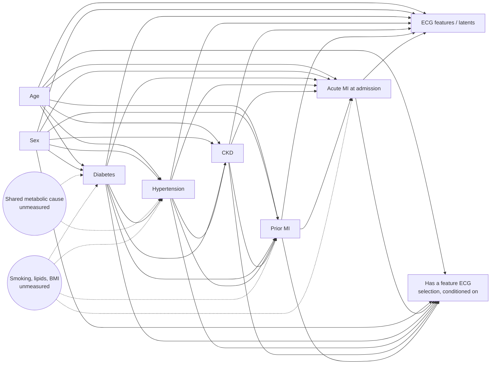

# Phase 4 — Causal Graph, Adjustment Sets and Graph Checks

**Date:** 2026-11-21 · **Code:** `graph.py` (graphs, d-separation checks), `p4_tests.py` (tests on the training split)
**Outputs:** `ADJUSTMENT_TABLE.csv`, `IMPLIED_INDEPENDENCIES.csv`, `INDEPENDENCE_TESTS.csv`, `p4_tests.json`

## 1. Revised graph (primary)

The ECG is **one multivariate node** (95 features, 64 latents). Features share waveform, leads and
delineation, so the graph claims nothing about independence between features. The previous attempt
treated them as separate nodes, and that sparse structure was contradicted.

**Not drawn, but part of the model:**
- Time from arrival to ECG is a consequence of MI and presentation, so analyses by time are descriptive.
- The look-back C (number of earlier admissions) affects how history is *recorded* (Section 4).
- Being hospitalised is conditioned on for everyone (Section 5).

## 2. What changed from the roadmap draft and why

| Change | Evidence |
|---|---|
| Diabetes → hypertension, plus an unmeasured shared metabolic cause (insulin resistance, obesity) | The draft implies D ⊥ H given age and sex. Observed adjusted OR 5.77 (95% CI 5.44–6.13), partial r 0.28 on 301,337 training admissions, far outside the pre-declared OR band 0.80–1.25. Strict flags give OR 6.20 among admissions with look-back (21.5 without restriction, inflated by shared structural zeros). Direction: diabetes causes hypertension through nephropathy and insulin resistance; the reverse is weaker clinically. |

Age ⊥ sex, the draft's only other testable implication, holds in Layer 1 (SMD 0.073 < 0.10).

## 3. Adjustment sets (`ADJUSTMENT_TABLE.csv`)

Validity is checked by the back-door criterion; Layer 2 also checks that ECG selection is ignorable
given exposure and the adjustment set (s-back-door). ✅ = valid under that graph.

| Exposure → outcome | Set | Roadmap draft | **Revised** | D→H only | H→D only | Shared cause only | Prior MI → CKD | Lifestyle U | Lifestyle U → ECG | Severity → selection |
|---|---|:-:|:-:|:-:|:-:|:-:|:-:|:-:|:-:|:-:|
| Diabetes → MI | age, sex | ✅ | ❌ | ✅ | ❌ | ❌ | ✅ | ❌ | ❌ | ✅ |
| Diabetes → MI | age, sex, HTN | ✅ | ❌ | ❌ | ✅ | ✅ | ✅ | ❌ | ❌ | ✅ |
| Hypertension → MI | age, sex | ✅ | ❌ | ❌ | ✅ | ❌ | ✅ | ❌ | ❌ | ✅ |
| **Hypertension → MI** | **age, sex, diabetes** | ✅ | **✅** | ✅ | ❌ | ✅ | ✅ | ❌ | ❌ | ✅ |
| CKD → MI | age, sex, D, H | ✅ | ✅ | ✅ | ✅ | ✅ | ❌ | ✅ | ✅ | ✅ |
| CKD → MI | + prior MI | ❌ | ❌ | ❌ | ❌ | ❌ | ✅ | ❌ | ❌ | ❌ |
| Prior MI → MI | age, sex, D, H, K | ✅ | ✅ | ✅ | ✅ | ✅ | ❌ | ❌ | ❌ | ✅ |
| **MI → ECG** (selected) | age, sex, D, H, K, prior MI | ✅ | ✅ | ✅ | ✅ | ✅ | ✅ | ✅ | ❌ | ❌ |

**Reading the table:**
- **Hypertension:** adjusting for diabetes is valid under the revised graph and every plausible variant
  except H→D. The roadmap's age-and-sex set is valid only if hypertension causes diabetes.
- **Diabetes:** under the revised graph no measured set identifies the total effect. Adjusting for
  hypertension blocks part of the effect (H is a mediator); not adjusting leaves the shared-cause path
  open. Report both sets side by side as an assumption-labelled bracket.
- **CKD:** robust across graphs except when prior MI causes CKD (then add prior MI, as the roadmap's
  "run both ways").
- **Prior MI:** descriptive only; any unmeasured coronary-disease cause breaks it.
- **Layer 2:** robust to every Layer 1 ambiguity, including unmeasured lifestyle causes of MI. It rests on
  two untestable assumptions:
  1. no unmeasured cause of both MI and the ECG (e.g. BMI lowers QRS voltage and raises MI risk);
  2. ECG recording does not depend on unmeasured acuity that also shapes the ECG.
  Phase 7 targets both: the chest-pain comparator and selection weights for (2), and a BMI sensitivity
  from OMR plus tipping-point bounds for (1).
- **Layer 1:** no set survives unmeasured lifestyle causes (smoking, lipids). As the roadmap says, Layer 1
  is a transparent confirmation with stated assumptions, bounded by E-values in Phase 7.

## 4. Look-back and recorded history (`p4_tests.json`)

| Association (training split, adjusted for age and sex) | OR (95% CI) |
|---|---|
| Any earlier admission → acute MI | 0.54 (0.51–0.56) |
| Any earlier admission → diabetes (primary flag) | 2.08 (2.02–2.15) |
| Any earlier admission → hypertension (primary flag) | 2.65 (2.57–2.74) |
| Any earlier admission → CKD (primary flag) | 3.48 (3.36–3.61) |
| Strict flags when there is no earlier admission | 0 by construction |

Look-back is linked to both recorded exposure and outcome, so it can bias Layer 1 through recording.
It is not added to the primary sets: chronic disease causes admissions, so adjusting for it can open a
path through unmeasured health status (collider bias). It stays as the Phase 1 sensitivity: restriction to
admissions with look-back, and look-back as a covariate. Primary flags (which include same-admission
codes) are less exposed than strict flags.

## 5. Testable implications and results (`IMPLIED_INDEPENDENCIES.csv`, `INDEPENDENCE_TESTS.csv`)

The draft graph is close to saturated. Over observed variables it implies only:

| Implication | Sample (train) | Effect size | Pre-declared threshold | Verdict |
|---|---|---|---|---|
| Age ⊥ sex | Layer 1 (301,337) | SMD 0.073 | \|SMD\| < 0.10 | Holds |
| D ⊥ H \| age, sex — primary flags | Layer 1 | OR 5.77, r 0.28 | OR 0.80–1.25, \|r\| < 0.05 | **Contradicted → graph revised** |
| D ⊥ H \| age, sex — strict flags | Layer 1 | OR 21.5 (6.20 with look-back) | same | **Contradicted** |
| ECG ⊥ selection \| parents | — | — | — | Untestable (no ECG when not selected) |

In Layer 2 rows the ECG selection (a common effect of age and sex) is conditioned on, so age ⊥ sex is not
implied there. The observed SMD −0.11 is what that selection predicts. The revised graph implies only
age ⊥ sex (holds). The test split was not used; it is reserved for the held-out check in Phase 5.

## 6. Assumptions the estimates rest on

1. Diagnosis codes at or before the admission reflect conditions present before the MI (Phase 2: 64–78%
   backed by an earlier admission).
2. After-onset ECGs follow MI onset (admission-context rule).
3. No unmeasured common cause of MI and the ECG beyond the adjustment set (Layer 2).
4. ECG recording is ignorable given MI and measured covariates (Layer 2).
5. No unmeasured common cause of each chronic condition and MI (Layer 1; known to be violated by smoking
   and lipids, hence bounds).
6. The shared metabolic cause of diabetes and hypertension does not act on MI except through them
   (otherwise the hypertension set also fails).
